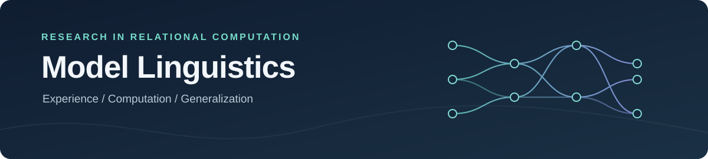

<div align="center">
  
  <h3>How does a Transformer learn to use a relationship?</h3>
  <p>Investigating how training experience, internal computations and linguistic generalization connect.</p>
  <p><a href="#research-at-a-glance">Research at a glance</a> · <a href="#what-we-have-found">What we have found</a> · <a href="#explore-the-research">Explore the research</a> · <a href="#getting-started">Getting started</a></p>
</div>

---

## Research at a glance

Language involves more than recognizing individual words. A model answering a question may need to select an event, identify a participant's role and combine those cues in context. **Model Linguistics** studies how such relational computations develop, interact across layers and generalize to unfamiliar combinations.

We work across two complementary research tracks. Results from one do not automatically establish a claim about the other.

| | Scratch-trained Transformers | Pretrained language models |
|:--|:--|:--|
| **Question** | How does controlled training experience change relational generalization and internal computation? | How do existing models use question, position and construction information to select participants? |
| **Approach** | Controlled data, paired initializations, protected evaluation and causal interventions | Qwen and Llama experiments, linguistic counterfactuals and activation interventions |
| **Explore** | [Overview](investigations/scratch_transformers/README.md) · [Evidence](investigations/scratch_transformers/CURRENT_FINDINGS.md) · [Scripts](investigations/scratch_transformers/EXPERIMENT_INDEX.md) | [Overview](investigations/pretrained_llms/README.md) · [Scripts](investigations/pretrained_llms/EXPERIMENT_INDEX.md) · [Reports](reports/cycle3/) |

## What we have found

These are research observations, not claims of a complete linguistic mechanism. Follow the links for protocols, controls and counterexamples.

| Evidence | What it tells us | Scope |
|:--|:--|:--|
| **Training exposure and generalization** | Matched training conditions produced a substantial difference on protected recombinations in ML-080, with a fresh-cohort behavioral replication in ML-084. | Synthetic two-event grammar; familiar names and verbs in new combinations. [ML-080](reports/ml080/protected_evaluation.json) · [ML-084](reports/ml084/protected_evaluation.json) |
| **Question-dependent causal effects** | In ML-085, a role-question-derived attention update directed answers toward the donor role more often than a matched event-donor control under the frozen primary rule. | Protected synthetic examples; intervention sensitivity does not establish native necessity or explain the exposure effect. [Protocol](reports/ml085/frozen_protocol.json) · [Results](reports/ml085/protected_causal_evaluation.json) |
| **Overlapping representations** | ML-086's role- and event-derived subspaces overlap; its primary erasure contrast narrowly met the frozen rule, with a bootstrap interval spanning zero. | The same subspaces may contain shared answer-relevant information. [Interpretation](reports/ml086/interpretation.md) · [Results](reports/ml086/protected_evaluation.json) |
| **A negative interaction test** | ML-087's residualized interaction-ablation contrast did not meet its frozen success criterion. | Exploratory evaluation on familiar calibration examples in the same models. [Protocol](reports/ml087/frozen_protocol.json) · [Results](reports/ml087/calibration_evaluation.json) |

Earlier failed hypotheses, alternative explanations and technical limitations are part of the evidence. See the [scratch evidence checkpoint](investigations/scratch_transformers/CURRENT_FINDINGS.md), [pretrained research track](investigations/pretrained_llms/README.md) and [evidence policy](docs/EVIDENCE_POLICY.md).

## Explore the research

- **[Scratch-trained Transformers](investigations/scratch_transformers/README.md)** — controlled learning, generalization and layerwise interventions.
- **[Pretrained LLMs](investigations/pretrained_llms/README.md)** — relational and linguistic computations in existing models.
- **[Reports and frozen protocols](reports/README.md)** — experiment plans, results and reproducibility notes.
- **[Shared resources](investigations/shared/README.md)** — analysis tools and research infrastructure.
- **[Historical research archive](https://github.com/Joel-Vazquez-Lopez/relational-transfer)** — earlier investigations and coordination.

## Getting started

The lightweight repository tests use Python 3.10+ and do not download model weights. Individual research scripts may require additional dependencies and their original checkpoints.

```bash
python3 -m venv .venv
source .venv/bin/activate
python -m pip install -e '.[dev]'
python -m unittest discover -s tests -v
python -m relational_lab.analysis examples/toy_counterfactual.json
```

### Repository map

| Path | Contents |
|:--|:--|
| [`investigations/`](investigations/) | Research-track overviews, evidence checkpoints and experiment indices |
| [`scripts/`](scripts/) | Canonical experiment scripts; paths are kept stable for imports and frozen protocol hashes |
| [`reports/`](reports/) | Research reports, frozen protocols and selected result summaries |
| [`src/relational_lab/`](src/relational_lab/) | Shared analyses and instrumentation |
| [`results/`](results/) | Tracked historical artifacts and local, often gitignored experiment outputs |
| [`tests/`](tests/) · [`examples/`](examples/) · [`docs/`](docs/) | Tests, small examples, provenance and workflows |

## Research standards

We preserve failed hypotheses, counterexamples, all seeds and frozen protocols. We distinguish exploratory findings from protected evaluations and independent replications, and candidate-restricted choices from full-vocabulary outputs. An activation intervention establishes sensitivity under that manipulation; it does not by itself identify a unique native algorithm.

Read the [scientific charter](docs/RESEARCH_CHARTER.md), [evidence policy](docs/EVIDENCE_POLICY.md) and [provenance guide](docs/PROVENANCE.md). Checkpoint files and recent raw outputs may be local and gitignored; do not assume they are available from GitHub. No open-source licence has been selected. Do not redistribute model weights or restricted datasets.
