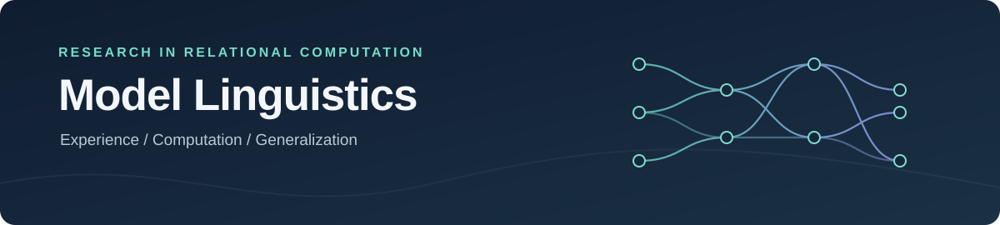

# Research guide — two studies of relational computation

[← Model Linguistics](README.md) · [Historical Development](investigations/README.md)

Understanding a sentence can require finding the relevant event, identifying its participants and selecting the role requested by a question. These studies approach that problem from **different experimental directions**.

| | Relational Learning in Transformers | Order-to-Role |
|:--|:--|:--|
| **Object of study** | Emergence and divergence under matched training conditions | Behavior and computation of pretrained LLMs |
| **Core contrast** | Exposure, event selection versus role binding, seed-dependent collapse | Order, grammatical function, semantic role and response condition |
| **Mechanistic angle** | Developmental trajectories, causal mechanisms and repair | Information at token positions, attention/MLP updates and answer selection |
| **External-validity limit** | A restricted synthetic grammar is not natural-language transfer | Marked constructions and answer formats can influence apparent errors |

---

## Paper I · Relational Learning in Transformers

**[Study overview](papers/learning-relations/README.md)**

*Emerging direction (provisional): Learning to Bind: Seed-Dependent Emergence and Collapse of Relational Computation in Transformers.*

The original controlled-exposure studies motivated a new question: why do identically configured scratch-trained models develop different relational abilities? Some master the task while others identify events but fail to distinguish participant roles. The independent 16-model study reproduced behavioural heterogeneity (9 successful, 3 intermediate, 4 collapsed) but failed its prespecified mechanism-category criterion. Expanded discovery is exploratory; repair specificity is inconclusive.

The ongoing ROLE-LEARNING-ORIGINS-v0 study crosses eight initialisation seeds with eight independent training streams (64 models). No scientific results are reported yet.

**Read:** [Current research direction](papers/learning-relations/README.md) · [Evidence](papers/learning-relations/EVIDENCE.md) · [Experiment map](papers/learning-relations/EXPERIMENTS.md) · [Reproducibility](papers/learning-relations/REPRODUCE.md)

The [existing working manuscript](paper/manuscript.md) remains unchanged. This direction is not a formally revised manuscript.
---

## Paper II · Order-to-Role

**[Study overview](papers/order-to-role/README.md)**

*Working direction: grammatical roles, response conditions and causal answer selection in pretrained LLMs.*

The experiments separate first-mentioned position, grammatical subjecthood and thematic role across controlled constructions. They also ask whether apparent errors change when a model is scored by first-token choice, instructed to reply with a bare name, or allowed to generate a sentence.

Development-only results include important **measurement artifacts**, unusual-question effects and within-item differences between response conditions. Layerwise probes, logit-lens measurements and activation interventions ask increasingly specific questions but should not be treated as interchangeable kinds of evidence.

**Read:** [Evidence and caveats](papers/order-to-role/EVIDENCE.md) · [Experiments](papers/order-to-role/EXPERIMENTS.md) · [Layer study](papers/order-to-role/LAYERS.md) · [Reproducibility](papers/order-to-role/REPRODUCE.md)

The November 25 manuscript snapshot organizes the investigation around name-state encoding, layerwise development, question-side readout and generality. English test0 was frozen on November 26, followed by a separate Spanish/Galician addendum; both have archived outputs. The full pass/fail audit is not asserted by this guide.

**[Paper architecture](papers/order-to-role/PAPER_MAP.md)** · **[Transfer and generality](papers/order-to-role/TRANSFER.md)** · **[Validation status](papers/order-to-role/EVIDENCE.md)**

**Current external research links:** [Code and stimulus branch](https://github.com/Joel-Vazquez-Lopez/llm-relational-mechanisms/tree/order-to-role/stimuli) · [Development and test0 results branch](https://github.com/Joel-Vazquez-Lopez/llm-relational-mechanisms/tree/order-to-role/results-dev/results) · [November review package](https://github.com/Joel-Vazquez-Lopez/llm-relational-mechanisms/blob/order-to-role/stimuli/docs/order_to_role/review_2026-11/README.md)

---

## Materials, ownership and research integrity

- [Repository map](papers/MAP.md) — canonical source locations and branch responsibilities.
- [Evidence policy](docs/EVIDENCE_POLICY.md) — what different types of observation do and do not establish.
- [Integration plan](docs/INTEGRATION_PLAN.md) — safe order for incorporating the remaining research work.
- [Historical pretrained investigations](investigations/pretrained_llms/README.md) — related earlier work; **not automatically an Order-to-Role replication**.

Every paper links to its own claims, controls, failure cases and experiment locations. Shared software is not shared experimental evidence.

*Navigation revision: 27 November 2026. Research material and conclusions remain subject to the versions and evidence gates in their original protocols.*
