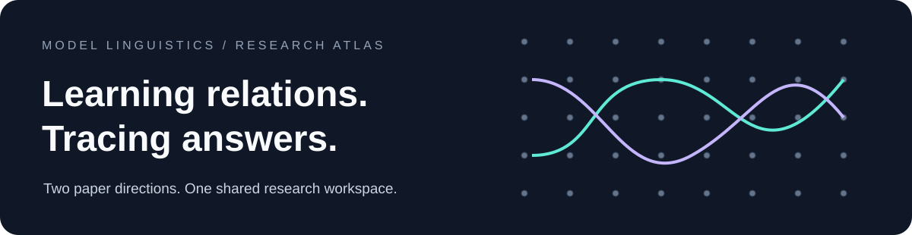

**[Learning relations](papers/learning-relations/README.md)** · **[Order-to-Role](papers/order-to-role/README.md)** · **[Layer study](papers/order-to-role/LAYERS.md)** · **[Repository map](papers/MAP.md)**

# Research overview

Two complementary studies investigate how Transformers learn linguistic relations and
how pretrained language models use them when answering questions. This guide connects
each paper to its evidence, methods, code and current research status.

| 🟢 01 · Learning relations | 🟣 02 · Order-to-Role |
|:--|:--|
| **How does experience teach a Transformer to use a relation?** | **How do LLMs turn grammatical information into an answer?** |
| Scratch-trained models · controlled exposure · joint-role errors · generalisation | Pretrained LLMs · word order and roles · question and answer format · layerwise computation |
| **Foundation:** repeated exposure benefits within a synthetic task family; heterogeneous error patterns. | **Foundation:** exploratory behavioral and intervention studies; measurement and causal interpretation remain under review. |
| Existing assets **frozen for preservation**; paper development active. | **Active**, exploratory OTR programme. |
| [Paper overview and evidence →](papers/learning-relations/README.md) | [Paper overview and evidence →](papers/order-to-role/README.md) |

## Reading guide

| Topic | Reference |
|:--|:--|
| Scratch-model manuscript | [Working manuscript](paper/manuscript.md) |
| Scratch-model evidence | [Evidence checkpoint](investigations/scratch_transformers/CURRENT_FINDINGS.md) |
| LLM study overview | [OTR paper hub](papers/order-to-role/README.md) |
| Layerwise analysis | [Layer-study map](papers/order-to-role/LAYERS.md) |
| Code, tests and documentation | [Repository map](papers/MAP.md) |
| OTR result data | [Results branch](https://github.com/Joel-Vazquez-Lopez/llm-relational-mechanisms/tree/order-to-role/results-dev/results) |
| Evidence standards | [Evidence policy](docs/EVIDENCE_POLICY.md) |

## Working together without mixing the evidence

The paper hubs are navigation and planning documents, not replacement protocols.
Existing files stay in their canonical locations, with frozen paths and hashes preserved.
Shared code in `src/relational_lab/` serves several studies.

OTR code currently lives on `order-to-role/stimuli`; links to that work explicitly use
that branch until its separate integration PR is merged. After integration, new OTR work
belongs on `main` or short-lived branches. Raw OTR results stay on
`order-to-role/results-dev` until release or Zenodo archival at freeze. The historical
99 results files already tracked on `main` remain untouched. Review figures and tables
under `docs/order_to_role/` are permitted documentation artifacts.

**Snapshot:** 18 November 2026 · [Ownership and open decisions](papers/MAP.md#ownership-and-open-decisions)
