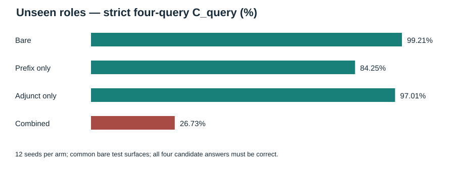
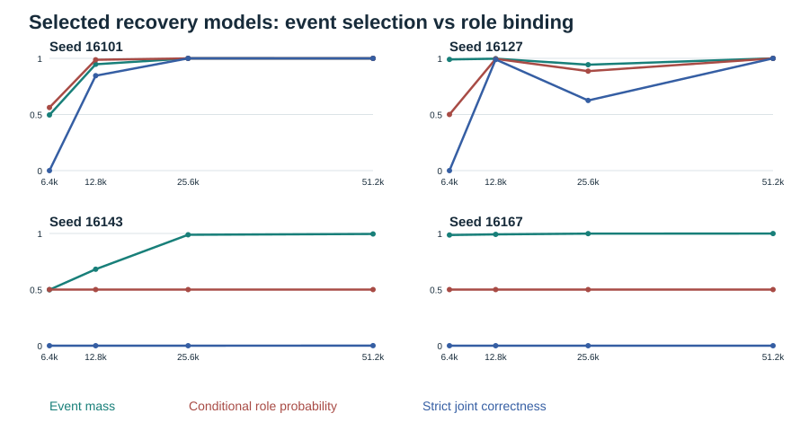
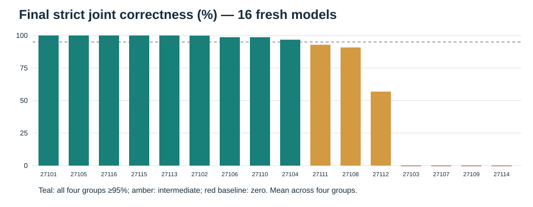

[← Paper I](README.md) · [Results](RESULTS.md) · [Methods](METHODS.md) · [Mechanisms](MECHANISMS.md) · [Experiments](EXPERIMENTS.md)

# Results: learning to bind

**Snapshot: 27 November 2026.** Values below are derived from pinned archived summaries, not newly trained models. The central result is not simply that exposure helps: complete relational competence is a seed-dependent outcome, and event competence can emerge without role discrimination.

## 1. Surface complexity reveals a generalisation failure

| Training arm | Train original | Unseen roles | Unseen quartets |
|---|---:|---:|---:|
| bare | 100.00% | 99.21% | 99.43% |
| frame_only | 100.00% | 84.25% | 85.05% |
| adjunct_only | 99.93% | 97.01% | 97.85% |
| frame_adjunct | 99.86% | 26.73% | 27.90% |

All arms learn original mappings; the combined surface arm often fails transfer. The frozen factorial primary and gated secondary passed, but this does not mean increased surface complexity improves transfer. See the exact contrast definitions in the [protocol](https://github.com/Joel-Vazquez-Lopez/llm-relational-mechanisms/blob/9c7146f88f96ad1c38de179c4ca8c3f26ebf1702/paper/TRAIN_SURFACE_FACTORIAL_V0_PROTOCOL.md) and [train_surface_factorial_v0](https://github.com/Joel-Vazquez-Lopez/llm-relational-mechanisms/blob/9c7146f88f96ad1c38de179c4ca8c3f26ebf1702/reports/train_surface_factorial_v0/analysis_summary.json). Cross-surface evaluation and the [role-anchor audit](https://github.com/Joel-Vazquez-Lopez/llm-relational-mechanisms/blob/10ab4c7bf2b56d3e8c8e396eee22e2e732a41910/paper/ROLE_ANCHOR_PROBE_V0_RESULT_AUDIT.md) suggest a quartet-specific original mapping shortcut: eight selected failing combined-arm seeds reproduced their original tuple on 87.74% of sampled bare test items. This is a post-hoc behavioural signature, not a proven lookup circuit.

## 2. More relational diversity did not solve acquisition at fixed budget

The prospective 16-seed four-arm diversity study compared 8 versus 1 trained mappings per quartet at 6,400 updates. The mean paired difference on rich unseen roles was **−16.55 percentage points** (95% t CI −33.12 to +0.015 pp; 0/16 positive). The primary failed; the gated secondary was not opened. This is a budget-specific result, not proof that diversity is harmful in general. [role_diversity_complex_v0](https://github.com/Joel-Vazquez-Lopez/llm-relational-mechanisms/blob/9c7146f88f96ad1c38de179c4ca8c3f26ebf1702/reports/role_diversity_complex_v0/analysis_summary.json).

## 3. Event competence can precede or survive failure of role binding

| Selected seed | Final event mass | Final conditional role probability | Final strict joint |
|---|---:|---:|---:|
| 16101 | 99.97% | 100.00% | 100.00% |
| 16127 | 100.00% | 100.00% | 100.00% |
| 16143 | 99.55% | 50.00% | 0.07% |
| 16167 | 99.92% | 50.00% | 0.00% |

These are exploratory roles_8 trajectories on rich unseen roles, averaged across voices. Recovery used a fresh optimiser from 6,400-step weights. Two models reached near-perfect event mass yet conditional role probability remained near 0.5. The other two recovered, and seed 16127 temporarily regressed. The selected four seeds are not a population estimate. [role_circuit_diagnostics_v0](https://github.com/Joel-Vazquez-Lopez/llm-relational-mechanisms/blob/9c7146f88f96ad1c38de179c4ca8c3f26ebf1702/reports/role_circuit_diagnostics_v0/analysis_summary.json).

## 4. Divergence recurs in fresh training runs

| Seed | Mean strict joint (%) | All four groups ≥95% |
|---|---:|---|
| 27101 | 100.00 | Yes |
| 27105 | 100.00 | Yes |
| 27116 | 100.00 | Yes |
| 27115 | 99.99 | Yes |
| 27113 | 99.98 | Yes |
| 27102 | 99.88 | Yes |
| 27106 | 98.69 | Yes |
| 27110 | 98.68 | Yes |
| 27104 | 96.76 | Yes |
| 27111 | 92.88 | No |
| 27108 | 90.79 | No |
| 27112 | 56.88 | No |
| 27103 | 0.00 | No |
| 27107 | 0.00 | No |
| 27109 | 0.00 | No |
| 27114 | 0.00 | No |

At 51,200 uninterrupted updates: **9/16 passed the frozen behavioural threshold**, 3 were intermediate and 4 had zero strict joint correctness. Intermediate/zero are descriptive subdivisions, not frozen mechanism classes. The original mechanism replication criterion failed (0 transferable, 0 source-dependent event; 7 successful but unresolved, 2 successful other). The expanded exploratory search recovered both old positive controls and one additional source-dependent model; it did not change that failed primary. [role_mechanism_replication_v0](https://github.com/Joel-Vazquez-Lopez/llm-relational-mechanisms/blob/9c7146f88f96ad1c38de179c4ca8c3f26ebf1702/reports/role_mechanism_replication_v0/analysis_summary.json) · [role_mechanism_discovery_v1](https://github.com/Joel-Vazquez-Lopez/llm-relational-mechanisms/blob/9c7146f88f96ad1c38de179c4ca8c3f26ebf1702/reports/role_mechanism_discovery_v1/analysis_summary.json).

## 5. Repair is possible, but reliable acceleration is unestablished

The first repair study found substantial recovery in one of four selected collapsed models. A follow-up varied eight continuation schedules from that same checkpoint; all targeted weighted runs remained below recovery threshold at 1,600 updates, and the primary contrast versus layer-matched weighted controls was zero (sign-flip p=1).

| Arm | Recovered by 6,400 / 8 |
|---|---:|
| full_ce | 4/8 |
| full_weighted | 3/8 |
| layer_ce | 0/8 |
| layer_weighted | 0/8 |
| random_ce | 0/8 |
| random_weighted | 0/8 |
| target_ce | 2/8 |
| target_weighted | 2/8 |

Final target-versus-layer matched mean differences were +24.89 pp (CE) and +24.80 pp (weighted), both p=.5. This is inconclusive, not a validated optimisation improvement. [role_repair_specificity_v1](https://github.com/Joel-Vazquez-Lopez/llm-relational-mechanisms/blob/9c7146f88f96ad1c38de179c4ca8c3f26ebf1702/reports/role_repair_specificity_v1/analysis_summary.json).

## 6. Current study: origins

64 fresh models cross eight initialisation seeds and eight training-stream seeds, keeping architecture and objective fixed. Dense diagnostics will distinguish when trajectories diverge; the protocol explicitly treats interaction/residual descriptively. No scientific outcomes are claimed here. [Frozen protocol](https://github.com/Joel-Vazquez-Lopez/llm-relational-mechanisms/blob/9c7146f88f96ad1c38de179c4ca8c3f26ebf1702/paper/ROLE_LEARNING_ORIGINS_V0_PROTOCOL.md).

## Figure provenance

The three SVGs are derived from the archived summaries linked in their respective sections. [Source data](figures/results_data.json) stores the exact values used. No uncertainty bands are implied for the selected trajectories. Full-vocabulary scores and causal tests are discussed separately in [Mechanisms](MECHANISMS.md).
