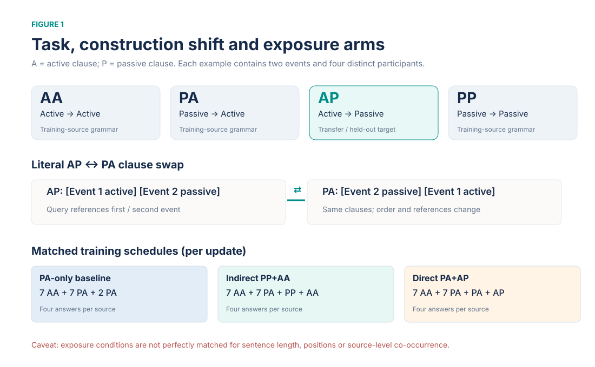
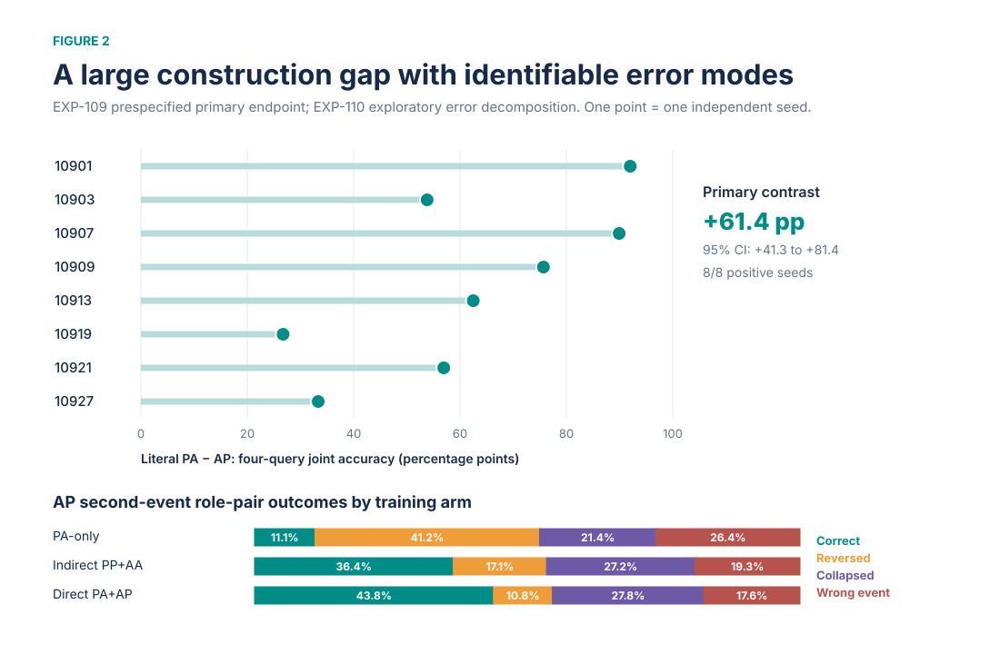
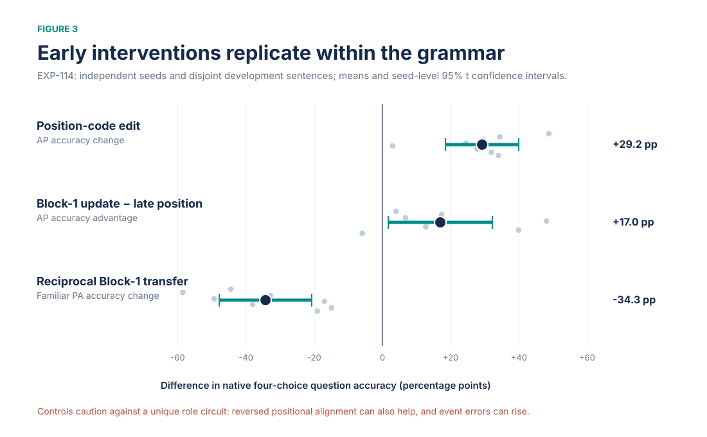
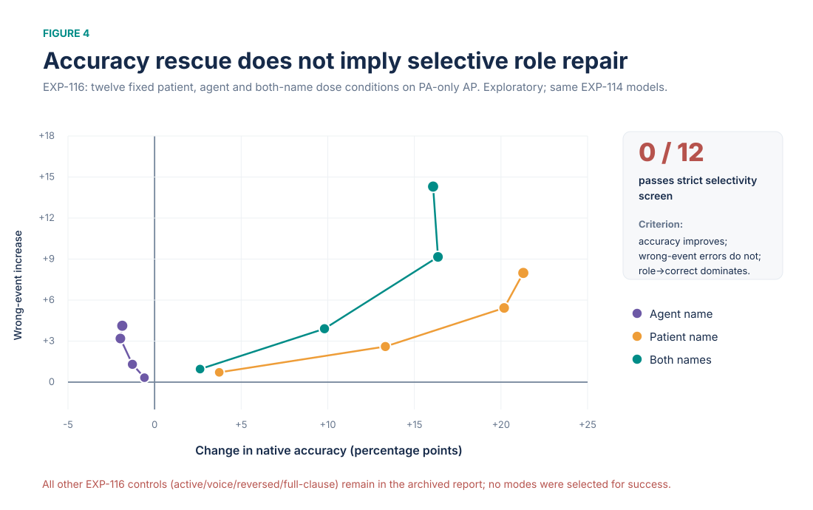
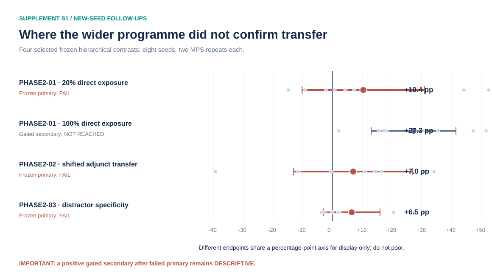

# Construction-sensitive semantic roles — scratch Transformer paper package

**Status:** complete first manuscript draft and reproducible evidence/figure bundle, prepared 2026-11-21. **Not yet submission-ready.**

This package was created from `experiments/exp102-clean-design` at `df82ab3ad9db5e13db80cf47caf8f2142afa3dc7`, in a dedicated branch to avoid changing experimental histories or the separate Order-to-Role project.

## Start here

- [First full manuscript](manuscript.md)
- [Claim-by-claim evidence ledger](evidence_ledger.md)
- [Scientific scope, stopping rules, publication gates](scope_and_decisions.md)
- [Next-study decision gates: shortcut baseline before new grammar](NEXT_STUDY_DECISION.md)
- [Archived-data extraction for the four figures](analysis/figure_data.json)

## Figures

1.  Controlled grammar, literal clause swap and training arms.
2.  Prospectively replicated construction gap + exploratory joint-error taxonomy.
3.  Three prespecified EXP-114 intervention tests with confidence intervals.
4.  EXP-116 targeted repair trade-off; no candidate passes selective-repair screen.
5.  PHASE2-01–03 prospective boundary tests. All three frozen primary tests fail.

The SVGs are included as immediately inspectable drafts. They are not polished submission figures. A separate plot script can reconstruct equivalent panels as PNG from the archived figure data.

## Validating the evidence data

From the repository root, in an environment with Python 3:

```bash
python papers/learning-relations/construction-shift/scripts/check_figure_data.py
```

This reads previously archived aggregate JSON reports **only** and checks the saved figure data against them, without loading checkpoints or scoring any protected examples.

To reproduce comparable raster versions from the frozen derived data (requires matplotlib):

```bash
python papers/learning-relations/construction-shift/scripts/render_figures.py
```

This outputs `figures/replot_fig1.png` through `replot_fig4.png` within this package. The bundled SVGs were produced from the same data and include more elaborate annotation; replot PNGs need not match the vector illustrations pixel-for-pixel.

## Interpretation

The paper's strongest passed tests are EXP-109 (behavior) and EXP-114 (early intervention) within one synthetic family. Later PHASE2-01–03 tests provide prospective negative boundaries (dose, adjunct order and distractor specificity). EXP-110–113 and EXP-115–116 are exploratory. No unique semantic-role circuit was proven, no external grammar generalization was demonstrated, and the reserved/protected/L+I evaluation gates remain closed.

## What still needs action

Verify original checkpoint/script hashes on the original Mac worktree, conduct independent figure/metric audit, implement shortcut baselines, select a venue, and decide whether new-grammar generalization is necessary. See [scope_and_decisions.md](scope_and_decisions.md).
