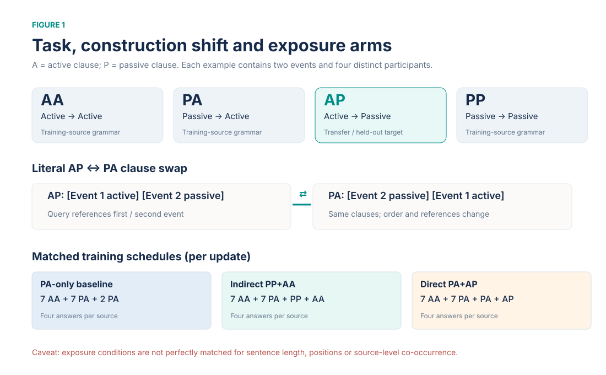
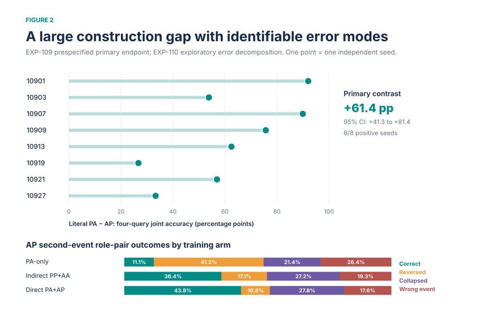
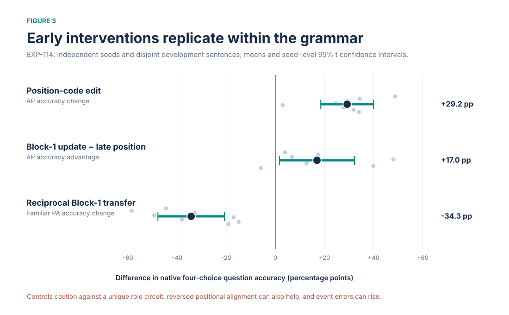
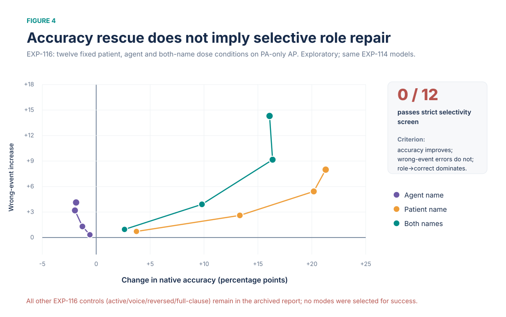
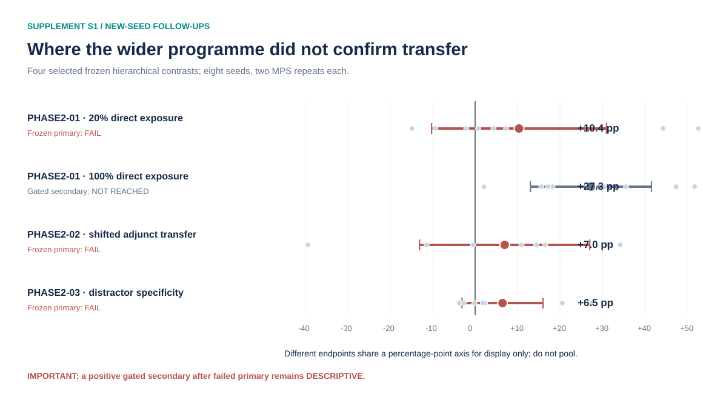
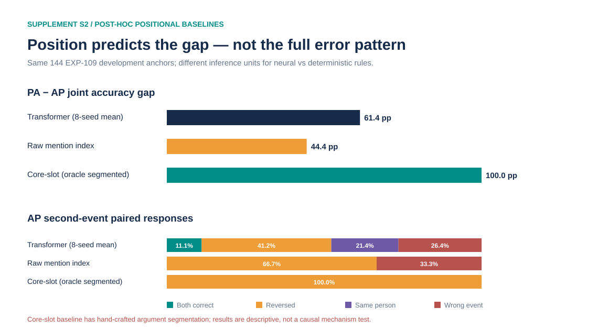
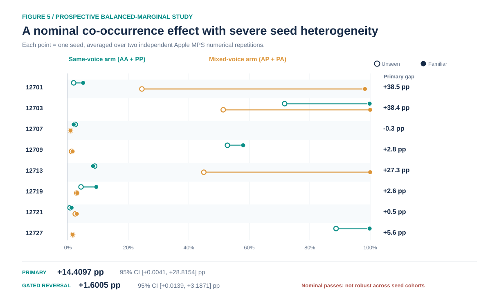

# When Position Matters: Construction-Sensitive Role Assignment and Causal Interventions in Small Transformers

**Working paper draft — 21 November 2026. NOT SUBMISSION-READY.**

*Authors and affiliations: to be supplied by the researchers. This package intentionally does not infer authorship from repository history.*

**Scope:** The scratch-trained Transformer experiments only; no Order-to-Role results are included.

## Abstract

Relational language understanding requires identifying the relevant event and assigning distinct semantic roles to its participants. We study construction-dependent relational question answering in three-layer causal Transformers trained from scratch on a controlled, two-event synthetic grammar. In a prospective eight-seed within-grammar study, a training condition without second-position passive exposure exhibits a 61.4-percentage-point difference in all-four-question correctness between two presentations containing the same clauses in reversed order (95% seed-level confidence interval: 41.3–81.4 points). Post-hoc decomposition shows that the difficult construction frequently produces complete agent–patient reversals rather than merely selecting participants from the wrong event. We then investigate where the difference is causally sensitive to positional information and early residual updates. In a separate, prespecified replication with eight new training seeds and disjoint within-family development sentences, passive-clause input-position editing increases native second-event answer accuracy by 29.2 points (95% CI: 18.5–40.0); learned first-block update transfer outperforms late positional-code transfer by 17.0 points (95% CI: 1.7–32.2); and reciprocal update transfer degrades familiar-construction accuracy by 34.3 points (95% CI for the negative effect: −47.8 to −20.7). Exploratory head/MLP and targeted interventions do not establish a unique grammatical-role circuit: accuracy gains can accompany wrong-event errors, and none of twelve candidate interventions satisfies a prespecified descriptive selectivity screen. Later prospective exposure, unseen-adjunct-order, and distractor-specificity studies did not pass their frozen primary success criteria. A post-hoc positional baseline analysis shows that large construction gaps can arise without a syntactic role algorithm. A subsequent checkpoint-only audit reveals a large drop from training-pool variants to familiar development name-set combinations despite near-ceiling training-pool performance; this complicates attribution of the later co-occurrence gap to relational composition alone. Our findings isolate a reproducible *within-grammar* behavioral asymmetry and constrain, without uniquely identifying, its early-layer computational basis.

**Keywords:** compositional generalization; semantic roles; causal Transformers; activation interventions; syntactic position; controlled experiments.

## 1. Introduction

A model may answer questions about simple relational descriptions correctly yet fail when the same familiar linguistic material appears in a new structural arrangement. This failure is more informative if we can distinguish choosing the wrong event, reversing the participants within the correct event, and assigning the same participant to complementary roles. Accuracy alone obscures these distinctions. Controlling grammatical exposure and reordering clauses offers a way to test construction sensitivity without simultaneously changing the lexical items and event meanings.

Mechanistic accounts of these behaviors face a separate evidential hurdle. A representation may contain linearly readable role information without the model using it for selection. Conversely, an activation transplant can alter an answer because it changes event access, position, or context-dependent computation; it need not isolate a role variable. A claim that a specific Transformer component implements grammatical-role binding requires stronger specificity controls than a positive patch effect.

We ask three questions. **RQ1:** Does a fixed training regime lead to a reproducible difference between literal AP and PA arrangements of the same two clauses? **RQ2:** Does the difference involve wrong-event choice, role reversals, or same-participant collapse? **RQ3:** Which early computations causally influence these answers, and can any tested intervention repair role choices *selectively* rather than shift errors to other events?

A post-hoc baseline audit further tests whether simpler position-only strategies can account for the result. Our contributions are narrowly scoped: a prospectively evaluated within-grammar construction gap (EXP-109), a transparent exploratory error taxonomy (EXP-110), a separate prospective within-family replication of three ordered intervention hypotheses (EXP-114), and exploratory specificity limits from first-block component and targeted-token interventions (EXP-115–116). We do **not** claim transfer to natural language, a new syntactic family, pretrained models, or a unique role-specific circuit.

*Figure 1.* Two-event constructions and the literal clause swap. A=active, P=passive. The PA-only baseline is not exposed to AP as an intervention construction during training; the competing schedules introduce different construction combinations. Identical clauses preserve lexical identities and event meanings across AP/PA presentations but change absolute positions, prefix contexts and question-reference assignments.

## 2. Background and related work

Controlled evaluations of compositional generalization distinguish familiar lexical recombinations from genuinely new structures. COGS (Kim and Linzen, 2020) introduced a semantic interpretation benchmark with structural generalization tests; SLOG (Li et al., 2023) expanded the structural challenge set. Their evaluation tasks and natural-language-like grammars differ from our small four-candidate question-answering task, and we do not claim direct benchmark comparison.

Training objectives and grammatical distributions can change whether Transformers generalize hierarchically (Ahuja et al., 2025, *Learning Syntax Without Planting Trees*). Our work is instead a controlled within-model study of passive voice position, joint response errors and source-state interventions. Tang, Lake and Jazayeri (2026) show that small synthetic-task Transformers may generalize through positional routing and support precise activation edits. This close methodological comparator means that observing position-sensitive effects is not in itself novel evidence for a grammatical mechanism.

What is potentially distinctive here is the *combination*: a controlled literal clause-reordering asymmetry, an event-versus-role error partition, a fresh-seed prospective intervention replication, and a demonstrated selectivity limitation. Whether this combination constitutes a sufficiently substantial publication contribution requires an explicit reviewer-style novelty audit rather than an assumption of uniqueness.

## 3. Task, models, and experimental protocol

### 3.1 Synthetic task and response measures

Each source contains two events with four distinct participants. Each event can be rendered in active or passive voice; AA, PA, AP, and PP designate the first and second event voices. Questions query the agent or patient of the first or second event, yielding four relational answers per source.

We distinguish four metrics. **Four-query joint correctness (`C_query`):** all four answers must be correct for a source. **Native four-name question accuracy:** fraction of individually correct answers when evaluated among the four mentioned names. **Full-vocabulary accuracy:** the correct answer must win against the full output vocabulary. **Second-event pair taxonomy:** for its complementary agent and patient questions, the native predictions are classified as both correct, both reversed, same participant for both questions, or at least one response from the wrong event. The pair taxonomy is mutually exclusive *as implemented for EXP-109/110* and should not be mixed arithmetically with the per-question wrong-role or wrong-event rates.

### 3.2 Model and controlled exposure

The EXP-109/114 model is a three-layer, width-96, four-head pre-layer-normalized causal Transformer trained from scratch with full-vocabulary cross-entropy, AdamW (learning rate 0.002, weight decay 0.01), and no dropout. Training lasts 6,400 fixed updates. At each update, the common core is seven AA and seven PA sources, plus two intervention sources, with four answer labels per source (64 labels/update).

The three conditions are: **PA-only** = common core + PA + PA; **indirect PP+AA** = common core + PP + AA; **direct PA+AP** = common core + PA + AP. The indirect condition offers second-position passive examples but does not present AP as such. The direct condition includes AP. These contrasts alter more than abstract compositional structure: sentence lengths, exact positions and source-level construction co-occurrence are not fully matched across arms. Accordingly, an indirect-training benefit cannot be uniquely attributed to abstract recombination.

### 3.3 EXP-109: prospective within-grammar construction comparison

Eight independently initialized seeds (10901, 10903, 10907, 10909, 10913, 10919, 10921 and 10927) were each run twice in separate Apple MPS processes. Neither failed nor low-competence models were excluded. A fixed 6,400-update endpoint was evaluated once per run, without favorable checkpoint selection.

The within-family development evaluation uses 144 fresh AP anchors: 16 for each of nine modifier combinations, drawn from the existing non-reserved development name sets using new participant orderings. Each anchor has a literal PA clause-reordered counterpart; the comparison keeps clause-internal tokens, event participants and event semantics unchanged. Reordering changes event position, preceding context and how first/second queries refer to the events. Other predefined derived presentations were recorded, including AA, PP, participant renaming and second-event reversal.

The **primary prespecified estimand** is PA-only `C_query(PA_literal) − C_query(AP)`. The **secondary prespecified estimand** is `C_query(AP | indirect) − C_query(AP | PA_only)`. Estimates average two numerical repeats within each independent seed; two-sided t confidence intervals use eight seed-level differences and seven degrees of freedom.

### 3.4 EXP-110–113: exploratory diagnosis and causal discovery

EXP-110 reanalyzed all 16 frozen EXP-109 runs without retraining. It partitions second-event answer pairs and measures per-question wrong-role/wrong-event differences. These are **post-hoc descriptive** outcomes, not new held-out confirmations. EXP-111 examined layerwise native readouts and probes; EXP-112 transplanted matching clause states; EXP-113 decomposed positional input changes and learned first-block updates. These results selected hypotheses for the later replication and must not be pooled as independent evidence.

### 3.5 EXP-114: prespecified independent-seed intervention replication

A separate set of eight seeds (11401, 11403, 11407, 11409, 11413, 11419, 11421 and 11427), with two MPS repetitions per seed and all three training arms, generated 48 final model states. Evaluation used 144 newly generated AP anchors and literal PA counterparts, disjoint from previously explored development surfaces but using the **same grammar and non-reserved development name sets**. All model states were retained.

The first ordered test replaces recipient passive-clause input positional codes with those from the matched reordered clause while recomputing all model blocks. The second compares transplanting the **Block-1 learned residual update** with replacing only the explicit positional code after Block 1. Writing token embedding `E_i`, absolute position embedding `P_i`, and end-of-block residual `h_i^(1)`, the donor update is `U_i = h_i^(1) − (E_i + P_i)`. Thus `U_i` is itself influenced by position, prior context and the model's learned computations. The third test checks whether the reciprocal update transplant harms familiar PA performance. The three hypotheses were frozen and assessed hierarchically; passing a later test required passing the earlier ones.

Controls include active-clause transplants, reversed donor alignment, participant-name-only and voice-cue-only position editing, wrong-event responses and collateral effects on non-target queries. None of these operations should be interpreted as a direct intervention on an isolated semantic-role latent variable.

### 3.6 EXP-115–116: descriptive specificity tests

EXP-115 decomposed Block-1 residual writes into individual attention-head, combined attention, and MLP contributions. EXP-116 applied fixed-dose transplants to passive agent names, patient names, both names and several other token sets. Both studies reused the EXP-114 checkpoints and development examples, so they are *exploratory follow-ups*, not independent confirmations.

EXP-116's strict descriptive screen examined twelve single-agent, single-patient and two-name dose configurations. A mode qualified only if the lower seed-level 95% CI for accuracy rescue was positive, the upper CI for wrong-event change was nonpositive, and the lower CI for wrong-role-to-correct transitions exceeded the upper CI for wrong-role-to-wrong-event transitions. This is a conservative heuristic screen, not a formal multiple-testing-adjusted test or a noninferiority design.

### 3.7 Later PHASE2 studies: training coverage and structural-order controls

Three further experiments, frozen *after* inspecting the preceding phase, used fresh seeds and previously unevaluated development surfaces while retaining the same three-block Transformer and two-event grammar. PHASE2-01 tested a five-dose direct PA+AP versus indirect PP+AA coverage curve, with eight independent seeds and two MPS repetitions. Its primary contrast was 20% versus 0% of dose-pair *steps* converted to direct PA+AP (not 20% of all training sources). PHASE2-02 used a new cohort of eight seeds to test p100-versus-p000 on two **unseen passive-adjunct placements** (near-tail and gate-infix), holding matched token bags and gold role answers fixed; this was a new surface order, not a wholly new grammar. PHASE2-03 used another eight new seeds to test whether moving a named other-event distractor to the passive-clause tail selectively increased prediction of that named distractor relative to the other wrong-event participant. All three studies fixed primary and gated secondary endpoints before their own experiments, and none opened protected/reserved or L+I tests.

### 3.8 Post-hoc positional-shortcut baselines

To test whether construction failure requires more than a simple source-position prior, we froze two deterministic baseline rules **before running them** on the already examined EXP-109 non-reserved development surfaces. Both baselines use the visible semicolon event boundary and the queried event index and role but **do not read grammatical voice, `was`, `by` or verbs to decide which candidate answers a question**. The raw-mention rule learns the most frequent answer mention index for each event/role/mention-count combination; the more generous core-participant-slot rule hand-strips task-specific adjunct names before learning the most frequent main-argument slot. It therefore has *oracle-like argument segmentation* unavailable to a generic position-only learner. Rules were fit to the original expected PA-only, indirect and direct training source-pool exposure frequencies, not to any seed's exact stochastic optimization trajectory.

The original pure-Python EXP-109 evaluation function was reconstructed without importing model-training code, and the original evaluation SHA-256 and relevant script digests were checked. Both rules were evaluated on exactly the same 144 previously archived development anchors and six conditions; 72 independent grammar fixtures passed. Model means from the original eight-seed EXP-109/110 audit are used for **descriptive comparison only**, not pooled as new hypothesis-test samples. This comparison is neither new independent model inference nor a held-out replication.

### 3.9 POSITION-CB-v0: balanced-marginal voice-combination experiment

A later, separately frozen experiment sought to distinguish marginal event-position exposure from co-occurrence generalization. **Same-voice** training presented AA and PP for each selected source core, while **mixed-voice** training presented AP and PA for the same core; all eight source cores, four agent/patient labels per source and aggregate token multisets were matched per update. Each event position was active once and passive once **within each arm's paired examples**, so marginal first-named role/voice evidence at each event position was balanced. The within-source voice pairing, and not necessarily all absolute token-position distributions, differed intentionally.

Eight new independent training seeds (12701, 12703, 12707, 12709, 12713, 12719, 12721, 12727), each with two MPS numerical repetitions, produced 32 scratch-trained model states at the fixed 6,400-update endpoint. Models were evaluated on 144 new non-reserved within-grammar development source cores, rendered in all four AA/PP/AP/PA combinations (576 presentations), with disjointness from previously studied surfaces and source orderings audited. No protected/reserved or within-event L+I data were used.

The prespecified **primary** estimand was the seed-paired, across-arm average of **familiar-minus-unseen `C_query`** (strictly all four answers correct): familiar=(AA,PP) for the same-voice arm and (AP,PA) for the mixed-voice arm. A gated **secondary** estimand, evaluated as confirmatory only upon primary success, was the unseen-minus-familiar rate of complete paired-role reversals, averaged across both event pairs and arms. Both tests used the original rule: positive lower limit of a two-sided 95% Student t interval over eight seed means, with two MPS repeats averaged within seed. No competence filters, seed selection or optional stopping were allowed. Other contrasts, including arm-by-exposure interactions and error-category decompositions, are exploratory.

## 4. Results

### 4.1 A large within-grammar construction gap

In the PA-only condition, **literal PA minus original AP four-query correctness was +61.37 percentage points** (95% t CI **+41.33 to +81.41**), with a positive difference for **8/8** independent seeds (Figure 2). This replicates a strong dependence on the construction's event position under the fixed training regime. The key secondary indirect-minus-baseline AP improvement was **+22.96 points**, but the 95% interval **[−2.11,+48.03]** includes zero. Indirect exposure is consequently promising but **not confirmed** on the preregistered endpoint.

Importantly, the clause-swap comparison by itself does not distinguish dependence on grammatical configuration from positional/answer-order heuristics. The PA-only model did not train on the second-position passive AP construction, so this effect is not surprising in isolation. The more informative results are the type of mistakes and the response to targeted interventions.

*Figure 2.* Upper: seed-level prespecified PA-only literal-PA-minus-AP `C_query` differences (EXP-109). Lower: exploratory native four-name taxonomy for AP second-event paired questions by training arm, from EXP-110. The same EXP-109 model runs are used for the lower panel; it is not a second replication.

### 4.2 Role reversals dominate the difficult construction's second-event errors

For the PA-only AP second-event agent/patient question pair, **11.1%** of events were answered correctly on both roles, **41.2%** were completely reversed, **21.4%** gave the same participant twice, and **26.4%** involved an answer from the wrong event. In the direct PA+AP arm, these descriptive proportions were **43.8%, 10.8%, 27.8%, and 17.6%**, respectively. The indirect PP+AA arm lay between these on correct and reversed pairs, while same-person answers remained common.

Relative to literal PA, the PA-only AP condition increased *per-question* wrong-role choices by **+32.44 points** (descriptive t CI **+25.79 to +39.10**) and wrong-event choices by **+9.23 points** (CI **+2.51 to +15.96**). The larger role error excess is visible in all eight seed comparisons. These rates are not independent additive pieces of the pair-level taxonomy.

The behavioral conclusion is that AP failures cannot be reduced simply to choosing the wrong event: the same-event participants are often selected in the opposite role assignment. This does **not** establish a representation of abstract roles that is subsequently swapped; a position-based selection heuristic could yield the same pattern.

### 4.3 Position-dependent and early learned updates causally influence answers

All three hierarchical prespecified EXP-114 intervention tests passed on new seeds and disjoint development sentence surfaces (Figure 3). Editing passive-clause input positional codes increased AP second-event native four-name accuracy by **+29.23 pp** (95% CI **[+18.49,+39.97]**, 8/8 positive). Transplanting first-block learned updates outperformed replacing explicit positional codes only *after* Block 1 by **+16.97 pp** (95% CI **[+1.73,+32.21]**, 7/8 positive). The reciprocal transplant into familiar PA reduced first-event accuracy by **−34.27 pp** (95% CI **[−47.80,−20.73]**, 8/8 negative).

These results establish that the tested upstream modifications can influence subsequent predictions and that early learned computation matters beyond a late explicit position-embedding edit. They **do not** establish that the Block-1 update is position-invariant, role-specific, sufficient for native role binding, or its unique mediator. In descriptive controls, reversing source-position correspondence sometimes preserved substantial effects and wrong-event selection could increase. Such effects weaken a narrowly role-specific explanation.

*Figure 3.* EXP-114 predeclared primary and two gated secondary comparisons; mean effects, seed-level 95% intervals and individual seed estimates. All refer to native four-name individual-question accuracy, not the strict four-query endpoint of EXP-109.

### 4.4 Causal influence is not selective semantic-role repair

EXP-115 indicates that different first-block residual contributions can change downstream choices, but isolated attention-head effects do not yield an independently demonstrated, unique grammatical-role circuit. Reversed and active-clause controls also respond, and the interventions can increase errors involving the other event.

In EXP-116, twelve fixed-dose candidate agent/patient/both-name transplants were assessed against the strict selectivity screen. **None qualified (0/12)**. The trade-off can be seen in Figure 4: some conditions improve native answer accuracy while simultaneously increasing wrong-event predictions. For example, transplanting the patient-name update at full dose yields a descriptive mean **+21.29 pp** accuracy change together with **+7.99 pp** wrong-event change; transplanting both names at full dose yields **+16.08 pp** accuracy with **+14.30 pp** wrong-event change. These are exploratory means on the previously evaluated sources, not independent estimates of a newly discovered repair method.

Consequently, the current evidence supports **intervention sensitivity**, not **selectively localized role correction**. A screen failure does not prove that no role-specific mechanism exists; only that this tested family of interventions did not demonstrate the stipulated selectivity.

*Figure 4.* EXP-116 exploratory accuracy versus wrong-event-rate changes in the twelve prespecified agent, patient and both-name dose modes, displayed as means across eight seeds. Dose lines are visualization aids; the full unfiltered mode set and confidence intervals remain in the archived EXP-116 report.

### 4.5 Phase 2 boundary tests: new independent seeds and previously unseen surfaces

The later prospective studies provide important independent-seed **negative primary tests**, rather than another unbroken sequence of discoveries (Supplement S1).

**PHASE2-01 (matched exposure curve):** The frozen 20%-versus-zero direct pair-exposure primary effect on AP second-event accuracy was **+10.35 pp**, 95% CI **[−10.27,+30.97]**, positive in five of eight independent seeds. It **failed** its prespecified success criterion. The 100%-versus-zero contrast was descriptively positive, **+27.30 pp** with CI **[+13.04,+41.56]**, positive in eight of eight seeds; however, this gated secondary test was **not formally reached** following failure of the 20% primary. The study thus does not confirm a particular minimum dose, monotonicity, or the nominal secondary as a passed confirmatory test.

**PHASE2-02 (unseen adjunct orders):** A fresh-seed prospective comparison of full versus zero direct PA+AP pair exposure on *shifted AP* gave **+6.97 pp**, CI **[−13.10,+27.03]**, positive in five of eight seeds. The **primary failed**. Canonical-versus-shifted contrasts suggest interesting differences but are exploratory. The study does not establish robust transfer of the exposure advantage to the two novel adjunct placements and does not evaluate a wholly different grammar.

**PHASE2-03 (distractor relocation):** The frozen p000 AP tail-versus-canonical named-distractor specificity contrast was **+6.46 pp**, CI **[−3.09,+16.00]**, positive in five of eight seeds, and **failed**. A p100 tertiary contrast had a descriptively positive interval, but the fixed-order gate had not been passed, so it cannot be reported as a successful confirmatory test. These results do not establish a dedicated distractor-binding mechanism.

Together these studies constrain the story: the reproduced construction gap and early intervention effects do not imply confirmed exposure-dose thresholds, broader structural transfer, or position-specific named-distractor capture. The later surface shifts are new within the original grammar, not independent grammar validation.

*Supplement S1.* Frozen primary and gated secondary contrasts from three new-seed cohorts. The four different metrics are displayed on the same percentage-point axis for audit only; they are not pooled. The positive PHASE2-01 p100 confidence interval is **descriptive** because its earlier p020 primary failed.

### 4.6 A positional shortcut reproduces the construction gap but not the complete error mixture

The frozen post-hoc shortcut audit passed the exact EXP-109 evaluation-digest and 72 grammar-fixture checks (Supplement S2). Under the PA-only expected exposure distribution, a deterministic **raw-name-mention lookup** achieved 0% AP and 44.4% literal-PA four-question correctness, yielding a **+44.4 pp** PA−AP gap. The **hand-segmented core-participant-slot rule** achieved 0% AP and 100% literal PA, a **+100 pp** gap. For comparison, the original scratch-trained PA-only models averaged **6.34%** AP and **67.71%** literal-PA joint correctness (+61.37 pp across eight independent seeds). Thus a large clause-reordering gap can arise from learned positional associations without a syntactically compositional semantic-role rule.

The baselines were *not* equivalent to the trained models. On AP second-event paired questions, the neural model averaged **11.1% both correct, 41.2% fully reversed, 21.4% same-person responses, and 26.4% wrong-event answers**. The raw mention shortcut produced **0%, 66.7%, 0%, 33.3%** on the same exhaustive categories; the optimistic core-slot shortcut produced **0%, 100%, 0%, 0%**. The fixed rules did not reproduce the neural model's same-person collapses. Moreover, both simple slot priors produced 0% AP `C_query` under all three exposure conditions, whereas the original neural means increased descriptively from **6.34%** (PA-only) to **29.30%** (indirect) and **35.81%** (direct). The EXP-109 indirect-minus-baseline contrast still had a confidence interval including zero and therefore remains inconclusive.

This is a **diagnostic limitation of the two specified shortcuts**, not proof that a sophisticated positional or memorization heuristic could not explain the model. The hand-segmented comparator is an optimistic, task-specific bound rather than an autonomous parsing model; all development examples had been previously explored. The result changes what is worth testing next: what produces the neural model's *mixture* of role reversals, duplicated answers and wrong-event choices, and which aspects of the exposure benefit survive stronger shortcut controls?

*Supplement S2.* Deterministic source-pool expected-frequency positional heuristics and the archived eight-seed Transformer results. These are different inference units; the comparison is descriptive and the baseline figures have no seed-level confidence intervals.

### 4.7 Balanced marginal exposure does not eliminate voice-co-occurrence sensitivity

The completed POSITION-CB-v0 run contains **16 processes, 32 final model states and eight independent training seeds**. Reanalysis of all original JSON reports reproduced the frozen results. The primary **familiar-minus-unseen** four-query accuracy contrast was **+14.4097 pp**, 95% seed-level t CI **[+0.0041,+28.8154] pp**, with 7/8 positive seeds. The secondary **unseen-minus-familiar complete role-reversal** effect was **+1.6005 pp**, CI **[+0.0139,+3.1871] pp**, likewise 7/8 positive. Both therefore **technically passed their frozen hierarchical criteria**, but the lower limits are only fractionally above zero.

The same-voice arm reached **35.44%** `C_query` on AA/PP and **28.93%** on its unseen AP/PA combinations (difference **+6.51 pp**). The mixed-voice arm reached **38.54%** on AP/PA and **16.23%** on its unseen AA/PP combinations (difference **+22.31 pp**). The paired difference of these two gaps is **+15.80 pp**, exploratory 95% CI **[−10.01,+41.61]**, with 4/8 positive seed-level interaction differences; therefore, the hypothesis that the mixed-voice training regime has a reliably larger generalization gap **is not confirmed**. The two unseen-combination sets are also different.

**Crucially, the model-training outcomes were extremely heterogeneous.** Some individual seed/arm models attained near-perfect familiar accuracy while others performed close to zero. **Three seeds (12701, 12703 and 12713) accounted for approximately 90.3% of the sum of seed-level primary differences.** An exploratory leave-one-seed-out audit produced confidence intervals bounded above zero for only 2/8 omissions. This demonstrates that the nominal successes do not imply reliable generalization across random initializations; all low-competence models were retained as prescribed.

The full paired-answer taxonomy is consistent with a more complex failure than role reversal alone. Averaged across arms, unfamiliar combinations reduced both-roles-correct answer pairs by **8.50 pp**, descriptively split into **+1.60 pp** complete reversals, **+2.35 pp** same-person collapses and **+4.55 pp** wrong-event selections. Individual-question accuracy decreased by **6.30 pp**. Only the previously frozen primary and gated reversal outcome were confirmatory; error partitions and condition-specific contrasts are exploratory, unadjusted follow-ups.

*Figure 5.* Familiar-versus-unseen strict four-query accuracy in both training conditions, for each of eight independently initialized seeds (each point averages two MPS repetitions). The highly heterogeneous proficiency across seeds is an essential part of the result. Differences in source-level co-occurrence remain even though per-event voice marginals, gold labels and aggregate token multisets are balanced. This is **not** an independent grammar-family transfer result.

See [raw-report reanalysis and provenance](analysis/position_cb_v0_audit.md) for all seed effects, the complete paired-error decomposition and exact confidence-interval boundaries.

### 4.8 A checkpoint-only audit localizes the larger failure to source-core or name-combination transfer

A subsequent **post-hoc read-only audit of all 32 final POSITION-CB-v0 checkpoints** compared the original familiar constructions on (i) source variants actually selected for training, (ii) training-pool variants never selected during that seed's 6,400 updates, and (iii) the original familiar development set. With 144 source indices sampled for each of the first two conditions, strict four-query correctness averaged **97.81%, 97.59%, and 35.44%** respectively for the same-voice arm and **91.95%, 91.73%, and 38.54%** for the mixed-voice arm. Pooling the paired arms at the seed level, the exact-seen and unused-variant rates were **94.88%** and **94.66%**, compared with **36.99%** on familiar development; the paired unused-pool-minus-development contrast was **+57.67 pp**, exploratory 95% t interval **[+32.52,+82.82] pp**. Single-question four-name accuracy showed the same pattern (**97.63%, 97.55%, and 58.29%**).

**This is evidence of a major train-pool–to–development transfer gap, not a direct diagnosis of lexical memorization.** Each unused pool index is a variant from the same train-only name-set/core generator: it was not presented at that exact index but may share its underlying event core, four-name set and lexical identities with extensively sampled training examples. The development partition instead uses disjoint **four-name combinations** and fresh event cores, while drawing individual names from the same vocabulary. Because two properties change together, these observations cannot separate event-core memorization, four-name-combination memorization or other train–development distributional changes. Near-zero final **sampled minibatch** losses in weak models cannot substitute for exhaustive evaluation.

Notably, some seed/arm models performed close to ceiling on the training pool yet near chance on even *familiar* development constructions. This places a major interpretive boundary on the POSITION-CB-v0 familiar-versus-unseen effect: a sizeable component of the low evaluation means reflects poor transfer beyond the original training source cores, **before** invoking unseen cross-clause voice pairing. The original prespecified nominal primary and gated secondary test results remain unchanged, with no exclusion of weak models.

The most informative low-cost next control is therefore a **checkpoint-only three-way core holdout**: exact train cores, never-presented event-core permutations constructed from *training name sets*, and development name sets. This would separate novel event arrangements within familiar four-name sets from novelty of the four-name set itself. It must use a frozen generation plan, source-only oracle and overlap audits, and remains exploratory unless an entirely new held-out test protocol is prospectively specified. A genuinely independent grammar remains necessary for cross-grammar claims.

### 4.9 New event-core assignments expose distinct semantic failure types

A completed post-hoc, read-only audit reused all **32** final POSITION-CB-v0 models and generated new role/event permutations **within the original 300 TRAIN name-quartet partition**. From 144 original training name quartets, we evaluated familiar-voice presentations of unchanged source cores, within-event agent/patient flips, swaps of the two event positions, and alternative participant pairings. All 16 model-process reports were independently reconciled to the frozen source manifest and the original summary. Source lengths, four-name identity, verb identities and voice combinations were controlled; changed-core text did not appear in the original training pool.

Original-core strict four-query accuracy was **97.63%** (same-voice) and **91.93%** (mixed-voice). This fell to **34.98%/37.36%** under role flips, **32.11%/37.32%** under event swaps, and **33.47%/37.35%** under new pairings. Averaging the two training arms within each seed, original-minus-manipulated drops were **+58.62**, **+60.07** and **+59.37 percentage points**, with exploratory unadjusted seed-level 95% t intervals **[+32.95,+84.28]**, **[+33.99,+86.14]** and **[+33.62,+85.11]**, respectively. These failures closely match the previously observed familiar-development results even though the four-name sets remain those used for training.

Crucially, the **error composition differs**: after role flips, complete paired agent/patient reversals averaged **34.76%/37.49%** in the same/mixed-voice arms, whereas event swaps produced **52.81%/59.55% wrong-event pairs**, and repartitioning **49.00%/57.92% wrong-event pairs**. Thus the accuracy collapse alone obscures distinct name-selection behavior. The 16 bare/bare anchors, which strictly preserve **all input-token counts** under role permutations, reproduce the original-minus-role-flip (**+58.72 pp**), swap (**+59.72 pp**) and repartition (**+59.50 pp**) gaps. Consequently, token-multiset changes from modifiers are not needed for the broad effect, although word position, shortcut priors and training-core associations remain plausible mechanisms.

This evidence does not prove literal sentence memorization or selective grammatical-role circuitry. A **prospectively frozen, fresh-seed training intervention** that changes exposure to role assignments while matching names, source lengths, tokens and supervision is required to test whether the suspected core-diversity dependency is causal. The present diagnostic is explicitly exploratory and did not open reserved/protected or original L+I evaluation. See [full numerical audit](analysis/position_cb_core_transfer_v0.md).

### 4.10 Prospectively varying role-core diversity does not meet the practical-effect threshold

CORE-DIVERSITY-v1 was a newly frozen, 16-independent-seed, four-arm intervention using 64 scratch-trained models, trained for 6,400 updates each. All arms used *bare/bare* two-event sources and either the same-voice (AA+PP) or mixed-voice (AP+PA) familiar exposure regime. For each exposure regime, models were trained on a single repeated agent/patient assignment per four-name quartet or on eight counterbalanced assignments. The primary test consisted of the other 16 **never-trained** role assignments on each of 240 training quartets. A gated secondary used all 24 assignments from 60 wholly withheld four-name quartets. All 16 reports, manifest digests and training schedules were independently checked against the frozen preregistered analysis.

The four arms reached **100% strict joint accuracy on evaluated original training cores**. On *held-out role permutations*, fixed-core same-voice and mixed-voice models already achieved **98.94%** and **98.03%** correctness, respectively; core-diverse counterparts achieved **99.998%** and **99.95%**. On *new name-quartet combinations*, fixed-core arms scored **99.28%** and **98.49%**, and diverse arms scored **100%** and **99.96%**.

The frozen primary contrast, diverse minus fixed averaged over the two voice regimes and across 16 independent paired seeds, was **+1.488 pp** (95% t CI **[+0.498,+2.479] pp**; 12/16 positive seeds). The protocol required three conjunctive criteria: positive lower CI bound, ≥10 pp absolute gain and ≥12/16 positive seeds. **The primary failed because the effect was below the predeclared +10 pp threshold.** Its nominally positive interval must not be promoted into a successful confirmatory test. The gated secondary estimated +1.095 pp (exploratory CI [+0.358,+1.832] pp), but its inferential gate remained **closed**.

This result reveals a major limitation of a single causal account based on the number of training event cores: **even fixed-core models trained on bare/bare inputs can generalize almost perfectly** to new roles and new name quartets. The earlier POSITION-CB-v0 failures are therefore not a general impossibility for fixed-core training. The two experiments differ in multiple other training factors, notably modifier/adjunct and sentence-prefix variation, quartet counts and schedules, and implementation details. Their contrast is scientifically informative but **not a randomized causal effect** of removing adjuncts or prefix frames. A separate factorial training-surface study would be needed to identify the responsible factor(s). See [independent reconciliation](analysis/core_diversity_v1_audit.md).

## 5. Discussion

The behavioral results complement existing work on structural generalization by providing a controlled view of *how* a construction shift fails. A model trained on limited syntactic exposure often maintains access to the appropriate pair of participants yet chooses the wrong mapping between them. The distinction between event selection and role assignment, and the distinction between single-question accuracy and paired consistency, matter because improvements in one dimension need not eliminate another failure.

The causal findings qualify explanations based solely on an externally edited positional vector. Position-code editing at input changes the entire ensuing computation, while late explicit positional editing has much less effect. Transplanting the Block-1 update changes predictions, including under reciprocal perturbation. But the donor update encodes all of the first block's context-dependent computation; it is not a direct measurement or intervention on abstract roles. Reverse-alignment effects and increased wrong-event choices are evidence against interpreting the best-performing patch as a selectively repaired semantic-role channel.

The later PHASE2 studies reinforce the generalization boundary: neither the 20%-dose primary effect, transfer of the exposure advantage to two novel adjunct placements, nor a primary named-distractor effect was confirmed. The separate positional-shortcut audit shows that a large PA–AP gap can be generated without syntactic role processing, while the fixed shortcuts do not reproduce the neural model's full error taxonomy or exposure-arm improvements. The position-counterbalanced study adds narrowly positive evidence that matching simple event-position voice marginals is not sufficient to eliminate *within-grammar* co-occurrence generalization failures. However, its nominally positive tests have near-zero confidence bounds and learning is extremely heterogeneous across seeds. Our evidence therefore supports a *restricted causal-computational claim*: certain position-sensitive early updates are influential in this synthetic task, while more ambitious descriptions of the model's native relational algorithm remain unresolved. This is a useful negative methodological lesson: success at changing an answer need not mean a causal explanation has isolated the information whose manipulation the experimenter intended.

## 6. Limitations and threats to validity

**Training-distribution sensitivity and across-cohort confounding.** The new CORE-DIVERSITY-v1 bare/bare conditions reach nearly 100% correctness even with fixed training role assignments, whereas old POSITION-CB-v0 models trained with modifier/neutral-prefix variation fail on novel event cores, including bare/bare heldout evaluations. The old and new cohorts also differ in data partition, schedule and implementation, so no individual cause of the discrepancy is isolated. The CORE-DIVERSITY primary missed its predeclared +10 pp meaningful-effect criterion despite a small positive confidence interval. Any claim that role-core diversity is necessary or that nuisance adjuncts causally produce shortcut learning would require a new matched prospective experiment.

**Single task family.** All prospective analyses involve one synthetic grammar, a small fixed architecture, familiar vocabulary/name partitions, four-answer question templates and fixed endpoints. New permutations, even when disjoint, do not amount to new grammars or a new model family. There is no natural-language or external benchmark result supporting the same phenomenon.

**Exposure confounding.** The PA-only baseline lacks AP intervention exposure. Indirect/direct comparisons alter second-position passive evidence, construction co-occurrence and potentially sentence length and token positions. The design therefore does not isolate an abstract recombination factor.

**Train–development distribution shift.** A checkpoint-only follow-up reveals approximately 95% joint correctness on original training-pool variants, including variants not literally sampled, but only 37% on familiar development items after pooling both arms. Because these sources change both event cores and four-name sets, this cannot distinguish core memorization from name-set-generalization failure; more granular controls are needed.

**Statistical power and numerical variation.** Eight independent training seeds is limited for estimating effects over possible model trainings. POSITION-CB-v0 displays especially severe learned-competence instability: several individual seed/arm trainings score near zero on familiar combinations, and the preregistered primary test is extremely sensitive to the seed cohort. The two Apple MPS repetitions are not additional independent seeds; within-seed repeat discrepancies were substantial for EXP-109 (mean absolute difference of 13.7 pp in the primary construction-gap effect; maximum 44.4 pp). Seed-level t intervals do not capture grammar-family or hardware-generalization uncertainty.

**Exploration versus confirmation.** The later role-pair decomposition, many patch modes, heads and selectivity screens are exploratory and reuse sources already examined. Their descriptive confidence intervals are not multiplicity-adjusted. EXP-114 prospective replication validates prespecified comparisons on fresh seeds and surfaces but remains within the same grammar and was motivated by prior exploratory selection.

**Causal interpretation.** Donor activation or position-code replacement can be off-manifold and is not guaranteed to hold unrelated computation fixed. Changes to wrong-event rates and non-target queries undermine a clean role-specific causal attribution. Readout/probe accessibility does not imply usage.

**Unfinished controls.** Two simple deterministic positional heuristics have now been evaluated post hoc and explain construction sensitivity in principle, but do not fully reproduce the neural error pattern. More comprehensive position-based learned baselines, an entirely new grammar and an independent architecture family have not been evaluated as primary confirmatory tests. PHASE2-02 already tested two novel passive-adjunct placements *within* the old grammar but failed its primary exposure-transfer criterion. These remain important possible reviewer requirements.

## 7. Conclusion

We establish a reproducible within-grammar construction-sensitive role-assignment failure in scratch-trained Transformers and provide a prospective causal-intervention replication linking downstream answer selection to positional inputs and early context-dependent updates. A complementary, explicitly exploratory decomposition shows that apparent accuracy rescue does not necessarily constitute selective repair of semantic-role assignment. A post-hoc position-only audit reproduces much of the construction asymmetry, though not the complete neural error mixture. The newer Phase 2 cohorts did not pass their frozen primary coverage-dose, adjunct-transfer or distractor-specificity tests. A separate balanced-marginal voice-pairing study nominally passed a new primary generalization-gap test and a gated reversal diagnostic but had borderline confidence limits and severe seed heterogeneity. A subsequent checkpoint-only audit showed good performance on both selected and never-selected training-pool variants, alongside a much larger failure on familiar development examples from disjoint four-name sets. New checkpoint-only role/event rearrangements within the same original train name quartets largely reproduce the failure, with complete role reversal predominating for within-event role flips and wrong-event choices for event swaps/repartitioning. The results argue for joint error diagnostics and stringent intervention specificity when making mechanistic claims about relational generalization. Future evidence is required before extrapolating to unseen grammars or a unique native role-binding circuit.

## Reproducibility and source provenance

The exact claim-to-report mapping, frozen branch commit, figure source extraction and stopping criteria are in [evidence_ledger.md](evidence_ledger.md), [scope_and_decisions.md](scope_and_decisions.md), and [analysis/figure_data.json](analysis/figure_data.json). Original protocols and data are on `experiments/exp102-clean-design`. The two MPS repeats are averaged within each seed. No protected/reserved or within-event L+I examples were opened for this draft. Source checkpoints are intentionally kept local and are not distributed here.

**Manuscript status:** expanded complete first scientific draft with POSITION-CB-v0, **not final submission text**. Required before submission: independent numerical review of plots, reproducibility commands against the actual worktree, a close novelty audit, shortcut baselines and target-venue formatting.

## References (provisional)

1. Kim, N., and Linzen, T. (2020). [COGS: A Compositional Generalization Challenge Based on Semantic Interpretation](https://aclanthology.org/2020.emnlp-main.731/). EMNLP.
2. Li, B., Donatelli, L., Koller, A., Linzen, T., Yao, Y., and Kim, N. (2023). [SLOG: A Structural Generalization Benchmark for Semantic Parsing](https://aclanthology.org/2023.emnlp-main.194/). EMNLP.
3. Ahuja, K., et al. (2025). [Learning Syntax Without Planting Trees: Understanding Hierarchical Generalization in Transformers](https://aclanthology.org/2025.tacl-1.6/). TACL.
4. Tang, C., Lake, B., and Jazayeri, M. (2026). [Circuit explained: How does a transformer perform compositional generalization](https://doi.org/10.1371/journal.pone.0340088). PLOS ONE.
