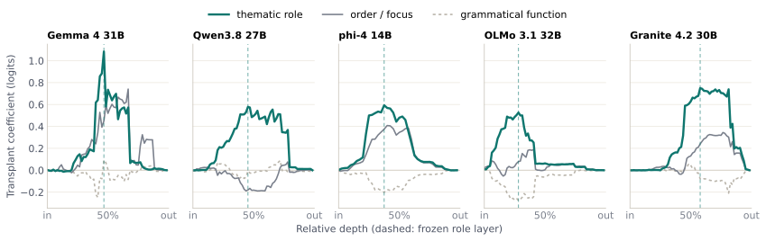
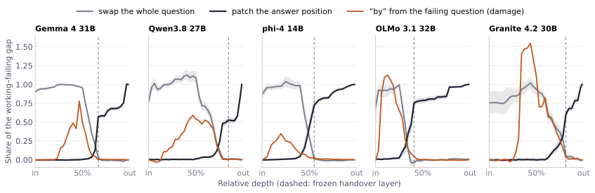
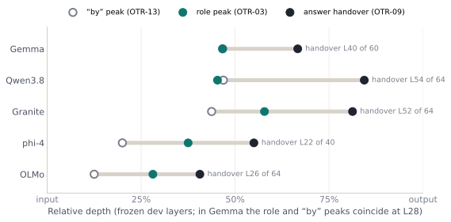

[← Order-to-Role](README.md) · [Results](RESULTS.md) · [Answers and interventions](INTERVENTIONS.md)

# Layers and mechanism: from the names to the answer

**Summary.** Causal interventions support a candidate three-stage account of how the answer is computed, with the stages in the same order in every model:

1. The names carry their thematic role in the middle layers.
2. The question, mainly through the word "by", sets which role is asked for.
3. At a fixed depth, the answer position takes over. Patching about 20 attention heads there repairs a substantial share of the error, and how much depends on the model.

The account is consistent with every intervention below, but it is not shown to be the models' unique native mechanism. The interventions establish sufficiency under patching. Knockout shows that the heads contribute much of the agent margin and change some answers, but most answers survive ablation (development; [Interventions §4](INTERVENTIONS.md#4-knockout-and-steering-otr-12)). Exclusivity is not tested (§6).

The stages sit at different depths in different models, but never in a different order. This page shows the evidence for each stage and what it does and does not establish. All curves are development data. The confirmatory tests for the layer claims are C2, C4, C6 and C8 ([evidence ledger](EVIDENCE.md#1-confirmatory-results-test-set-0)).

## 1. Stage one: the role code on the names (OTR-03)

- **The role coefficient rises** from about a quarter of the depth, **peaks** between 28% (OLMo) and 58% (Granite), and **falls to zero** near the output, where the answer no longer depends on the name states.
- **Grammatical function stays near zero or below**; it is negative in OLMo and phi-4 in the middle layers.
- **Order/focus** follows role at a lower level in Gemma, phi-4 and Granite. It is absent or negative in Qwen3.8 and small in OLMo.
- **Spanish and Galician.** The role code transfers to both languages at the English role layer [test0, XL-C2], but grammatical function is also positive there, most clearly in Qwen3.8 (function .56 Spanish, .53 Galician) and phi-4 in Spanish (.34, equal to role).

Interpretation: a name's state carries a code that behaves like its thematic role, built before any question token is read. The model reads the sentence before the question, so this code cannot depend on which question follows.

## 2. Stage two: the question and the word "by" (OTR-13, OTR-14)

The working and failing questions differ only after the sentence. Swapping single question tokens shows where the difference sits:

| Model | "by" layer (peak) | Damage from failing "by" into working question | Repair from working "by" into failing question |
|:--|--:|--:|--:|
| Granite 4.2 30B | 28 | 1.55 | .49 |
| OLMo 3.1 32B | 8 | 1.12 | .75 |
| Gemma 4 31B | 28 | .78 | .32 |
| Qwen3.8 27B | 30 | .59 | .22 |
| phi-4 14B | 8 | .35 | .57 |

*Share of the working–failing gap at the "by" peak. Damage values are recomputed from the frozen OTR-13 files; repair values are transcribed from the [results log, 23 Nov](https://github.com/Joel-Vazquez-Lopez/llm-relational-mechanisms/blob/9c437928f61351a72e8d7be4cac6d3a964844a7e/docs/order_to_role/state_2026-11-25/results_log.md).*

- **The damage claim is confirmed in all five models [test0, C6].** A "by" taken from a patient question ("Who was praised by someone?") also damages the working answer [test0, C8].
- **"someone"** matters only in the earliest layers. Ablating the verb makes the error worse rather than repairing it.
- **"by" is the main entry point, not the only one.** With a second working question ("Who was the V-ing of someone done by?") part of the difference stays at the end of the question, and in Gemma it moves to "?". The failure depends on "someone V-ed" directly before "by".

## 3. Stage three: the handover to the answer position (OTR-09, OTR-14)

Two curves cross. Swapping the whole question from a layer upward repairs the failing answer almost fully in early and middle layers, then drops to zero. Patching the answer position does nothing early and starts to repair at the same depth. Before the crossing, the decision still depends on the question tokens; after it, the answer position carries it. The first layer where answer-position repair reaches .5 is the **handover layer**.

| Model | Layers | Handover, English | Depth | Spanish / Galician (frozen) | UD | Wikipedia (real / neutral) |
|:--|--:|--:|--:|:--|--:|:--|
| OLMo 3.1 32B | 64 | 26 | .41 | 24 / 26 | 24 | 22 / 24 |
| phi-4 14B | 40 | 22 | .55 | 22 / 22 | 22 | 22 / 22 |
| Gemma 4 31B | 60 | 40 | .67 | 46 / 46 | 40 | 40 / 40 |
| Granite 4.2 30B | 64 | 52 | .81 | 52 / 52 | 52 | 52 / 52 |
| Qwen3.8 27B | 64 | 54 | .84 | 50 / 50 | 60 | 60 / 60 |

*English: frozen development layer, recomputed from the OTR-09 file. Spanish/Galician: frozen in the addendum from development runs. UD and Wikipedia: first crossing in the development transfer runs ([`head_transfer_dev.csv`](results/tables/head_transfer_dev.csv)).*

- **On held-out names the handover reappears at exactly the frozen layer** in all five models [test0, C4]. In Spanish and Galician it falls within the ±2-layer tolerance of the language-specific frozen layer; for Gemma the first crossing is at 48 against a frozen 46 [test0, XL-C4].
- **The handover moves in two models.** Gemma's is later in Spanish and Galician than in English (46–48 vs 40), and Qwen3.8's is later on natural text (60 vs 54).

## 4. The heads at the handover

From the handover layer on, patching 20 attention heads, ranked on part of the development families, repairs a substantial, model-dependent share of the error. On the remaining families they repair .36 (Qwen3.8) to .82 (Gemma), against ≤ .11 for 20 random heads from the same layers. Frozen and applied unchanged to held-out names, Spanish, Galician and natural text, they keep each model's level of repair ([Results §4 and §6](RESULTS.md#4-twenty-heads-repair-a-substantial-model-dependent-share-of-the-error)). The head lists are in [FREEZE.md §4](https://github.com/Joel-Vazquez-Lopez/llm-relational-mechanisms/blob/9c437928f61351a72e8d7be4cac6d3a964844a7e/docs/order_to_role/FREEZE.md); the heads were searched only in a window of late layers, which in OLMo began after its handover, so their location shows that late heads suffice, not where the read-out happens.

## 5. Across models: same order, different depths

In all five models the role peak and the "by" peak precede the handover. The depth at which this happens varies by a factor of two: OLMo hands over at 41% of its depth, Qwen3.8 at 84%. Different networks thus place comparable computations at different depths. This links to [Paper I](../learning-relations/README.md), where identically configured small models reach different internal solutions; the two papers do not claim the mechanisms are identical.

## 6. What the layer evidence does and does not show

- **It shows sufficiency, and partial necessity.** Patching a state or head from the working run is enough to change the answer. Ablating the top-20 heads removes 51–82% of the agent margin in four models (16% in OLMo), while most answers stay correct (development, OTR-12). The heads are therefore an important route for the information, not the only one.
- **The ordering of peaks is descriptive.** The serial account is supported by the crossing of the two swap curves and by the token-level tests, but "A peaks before B" alone is not a causal chain. The pipeline ordering (OTR-14) is exploratory under the freeze; the specific token interventions (C6, C8) are confirmatory.
- **Depth fractions compare models with different architectures.** Qwen3.8 is a hybrid-attention model, so equal fractions do not mean equal computations.
- **Some OTR-14 curves need standard attention interfaces.** Where a model lacks them, the curve is missing and is reported as missing.

The code for each measurement is listed in the [experiment map](EXPERIMENTS.md).
