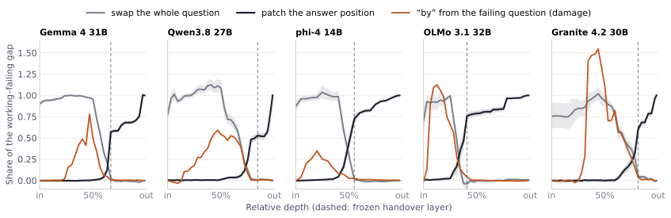

[← Model Linguistics](../../README.md) · [Research history](../../investigations/README.md) · [Paper I](../learning-relations/README.md)

# Paper II · Order-to-Role

### How pretrained language models store who did what to whom, and how a question reads it out

*Working title: "Thematic roles live on the names: how language models represent who did what" (provisional).*

**Status, 27 November 2026.** Development work is complete for five open models. Eight claims were frozen on 26 November and tested once on held-out names: **37 of 38 checks pass** in English, **15 of 15** on a broader English replication, **29 of 30** in Spanish and **30 of 30** in Galician ([scorecards](EVIDENCE.md#1-confirmatory-results-test-set-0)). A 70B-class extension is in exploratory development. Manuscript in preparation.

---

## The question

*Leon praised Mira* and *Mira was praised by Leon* describe the same event. In the first, Leon is the first name, the grammatical subject and the agent. In the second, he is still the agent, but he is neither first nor the subject. Linguistic theory keeps three properties apart that usually travel together: **word order**, **grammatical function** and **thematic role**.

When a language model answers "who did it?", which of the three does it actually use? Where in the network is that information, and how does a question get to it?

| Construction | Example | First name | Subject | Agent |
|:--|:--|:--|:--|:--|
| Active | Leon praised Mira. | Leon | Leon | **Leon** |
| Passive | Mira was praised by Leon. | Mira | Mira | **Leon** |
| Object cleft | It was Mira that Leon praised. | Mira | Leon | **Leon** |
| By-cleft | It was by Leon that Mira was praised. | Leon | Mira | **Leon** |

Across these four constructions the three properties are exactly uncorrelated, so their effects can be separated.

## What we found

1. **The names carry their thematic role.** Moving the hidden state of a single name from one sentence into another shifts the answer according to that name's role. Grammatical subjecthood has almost no effect. The role signal peaks in the middle of the network (28–58% of depth) in all five models, and is the largest of the three effects there. Word order or focus also carries a smaller signal in three models. → [Results §2](RESULTS.md#2-the-names-carry-their-thematic-role)
2. **A question reads the role out late, through a small set of attention heads.** At one model-specific depth the question's contribution is handed to the answer position. From there, 20 attention heads are enough to repair most of an error, against about 0–11% for 20 random heads from the same layers. → [Results §3–4](RESULTS.md#3-from-storage-to-answer-the-layer-pipeline)
3. **Storage and retrieval come apart.** One wording, *"Who was someone praised by?"*, makes models name the patient although the sentence, and therefore every hidden state of the names, is identical to a working question. The failure enters at the word "by", and three models still know the agent when asked differently. → [Results §5](RESULTS.md#5-stored-correctly-retrieved-wrongly)
4. **The same heads work beyond the templates.** Heads chosen on English template sentences repair answers on new English verbs, Spanish, Galician, Universal Dependencies sentences and Wikipedia text, with real or neutral names. → [Results §6](RESULTS.md#6-beyond-the-templates-new-words-languages-and-natural-text)
5. **The claims hold on held-out data.** The claims, layers, heads and pass rules were committed publicly before test set 0 was opened. → [Results §7](RESULTS.md#7-held-out-confirmation)

*In every model, the question matters until a fixed depth, after which the answer position carries the decision (development data; [details](LAYERS.md)).*

---

## Read the paper's evidence

| | Page | What it covers |
|:--|:--|:--|
| 1 | **[Results](RESULTS.md)** | The findings in order, with figures and tables, development and confirmatory results kept apart |
| 2 | [Methods](METHODS.md) | Linguistic design, stimulus sets, models, prompting, scoring, interventions, splits and freeze |
| 3 | [Layers and mechanism](LAYERS.md) | Role code across depth, question-to-answer handover, the "by" token, cross-model layer order |
| 4 | [Answers and interventions](INTERVENTIONS.md) | Answer generation, the scoring artefact, head repair, knockout, steering and controls |
| 5 | [Generality](TRANSFER.md) | New constructions, Spanish, Galician, natural sentences, real vs neutral names, 70B models |
| 6 | [Evidence ledger](EVIDENCE.md) | Confirmatory scorecards; exploratory, failed, inconclusive and ongoing work; corrections |
| 7 | [How it developed](DEVELOPMENT.md) | From the first behavioural test to the frozen evaluation, including dead ends |
| 8 | [Experiment map](EXPERIMENTS.md) | OTR-01 to OTR-15 and the stimulus generators |
| 9 | [Manuscript map](PAPER_MAP.md) | Section and figure plan of the working manuscript |
| 10 | [Reproduce](REPRODUCE.md) | Rebuilding every table and figure, and re-scoring the frozen evaluation |
| 11 | [Integration](INTEGRATION.md) | Where the code and results live now, and the plan to unify them on `main` |

## Models and scope

Five instruction-tuned open models of 14–32B parameters passed a behavioural inclusion gate fixed on development data: **Gemma 4 31B-it, Qwen3.8-27B, phi-4, OLMo-3.1-32B-Instruct and Granite-4.2-30B**. Llama-3.3-70B-Instruct and Qwen2.5-72B-Instruct are an exploratory extension. Earlier pretrained-model experiments in the [historical record](../../investigations/pretrained_llms/README.md) motivated this study, but they are not part of its evidence.

## Where things live

The numbers on these pages are rebuilt from archived result files by [`analysis/build_results.py`](analysis/build_results.py). Source commits and the checksum of every input file are recorded in [`results/MANIFEST.json`](results/MANIFEST.json). The current OTR code is on [`order-to-role/stimuli`](https://github.com/Joel-Vazquez-Lopez/llm-relational-mechanisms/tree/order-to-role/stimuli) and the outputs are on [`order-to-role/results-dev`](https://github.com/Joel-Vazquez-Lopez/llm-relational-mechanisms/tree/order-to-role/results-dev). The [integration plan](INTEGRATION.md) moves the code to `main`.

*Paper II section revision: 27 November 2026. Code snapshot `9c43792`, results snapshot `25c6914`.*
