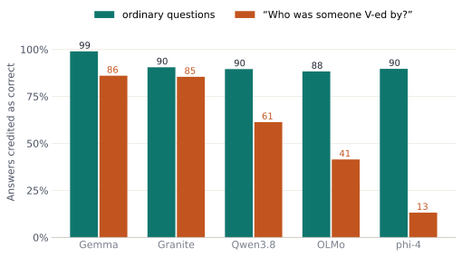
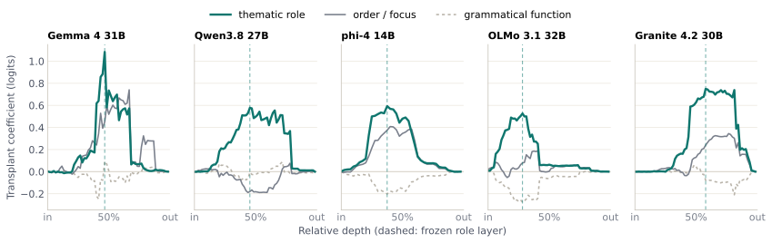
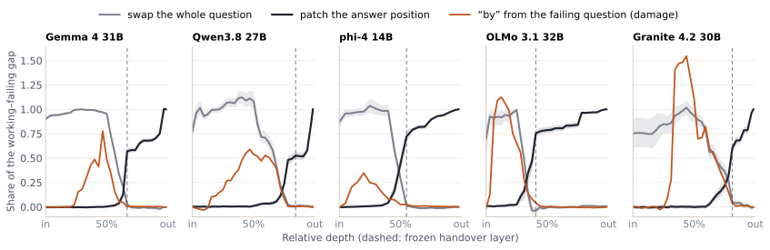
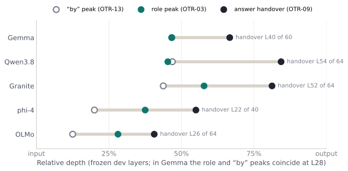
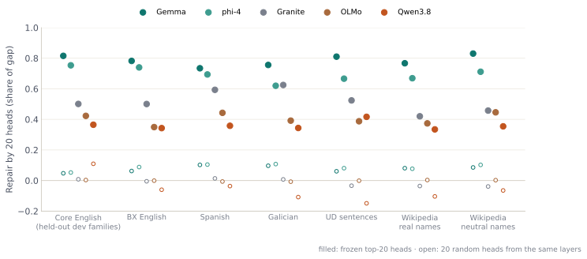

[← Order-to-Role](README.md) · [Methods](METHODS.md) · [Evidence ledger](EVIDENCE.md)

# Results

The findings below are presented in the order of the argument: what the models do, what the names encode, how a question reads it out, why that read-out can fail, how far it generalises, and what held on held-out data.

**Two kinds of evidence are kept apart throughout:**

- **Development (exploratory).** Results on the development split (15% of name-pair families). All layers, heads and hypotheses were chosen here. Tables named `*_dev.csv`.
- **Confirmatory (test set 0).** Eight claims frozen in a public commit ([`f6ea0e1`](https://github.com/Joel-Vazquez-Lopez/llm-relational-mechanisms/commit/f6ea0e1), 26 Nov), tested once on 59 held-out name-pair families with the frozen scorer. Spanish and Galician followed under a separate addendum ([`3811d7c`](https://github.com/Joel-Vazquez-Lopez/llm-relational-mechanisms/commit/3811d7c)). Marked **[test0]**.

Every number comes from [`analysis/build_results.py`](analysis/build_results.py) run on results snapshot `25c6914`. The tables are in [`results/tables/`](results/tables/), the scorer outputs in [`results/confirmatory/`](results/confirmatory/), and input checksums in [`results/MANIFEST.json`](results/MANIFEST.json). The 38 development files the freeze was built from match the checksums recorded in [`freeze_inputs.sha256`](https://github.com/Joel-Vazquez-Lopez/llm-relational-mechanisms/blob/9c437928f61351a72e8d7be4cac6d3a964844a7e/docs/order_to_role/freeze_inputs.sha256) (38 of 38).

---

## 1. Behaviour: one question wording fails, and scoring matters

**Measuring behaviour in chat models needed a correction first.** Early runs scored the first answer token as a choice between the two names. Instruction-tuned models often restate the sentence before answering, so this "forced choice" mostly recorded which name the reply started with. On development items it produced an apparent subject–object asymmetry that free generation does not show. Qwen2.5-14B-Instruct, for example, went from .71 under forced choice to .96 when generating with the instruction "Reply with one name only" ([review package, table t1](https://github.com/Joel-Vazquez-Lopez/llm-relational-mechanisms/blob/9c437928f61351a72e8d7be4cac6d3a964844a7e/docs/order_to_role/review_2026-11/tables/t1_forced_choice_vs_generation.csv); different item samples). The artefact is not uniform: OLMo-2-13B moved the other way (.88 → .81). From then on, behaviour was scored on generated answers with a rule-based extractor ([details](INTERVENTIONS.md#1-measuring-the-answer)).

**With generation scoring, the five study models answer ordinary questions well, but one wording fails.** "Who was someone V-ed by?" asks for the agent, exactly like "Who was the V-ing done by?". The models nevertheless often name the patient:

*Broader English development set (BX transitive: new names, verbs and 18 constructions; 1,440 prompts per condition per model). Source: [`behaviour_dev.csv`](results/tables/behaviour_dev.csv).*

| Model | Core set: working question | Core set: failing question | BX: ordinary questions | BX: failing question |
|:--|--:|--:|--:|--:|
| Gemma 4 31B | 1.00 | .69 | .99 | .86 |
| Granite 4.2 30B | .99 | .80 | .90 | .85 |
| Qwen3.8 27B | .97 | .52 | .90 | .61 |
| OLMo 3.1 32B | 1.00 | .68 | .88 | .41 |
| phi-4 14B | .89 | .11 | .90 | .13 |

The selective failure is confirmed on held-out names in every model (C1, working minus failing: .16 to .77, all intervals above zero) **[test0]**. The errors are not random: the wrong answer is the patient.

## 2. The names carry their thematic role

**Method in one sentence.** We copy the hidden state of a single name from a source sentence into a base sentence at one layer, and measure how much the answer moves towards that name. A regression within each base sentence and slot then separates the effect of the source name's order, grammatical function and thematic role ([METHODS §4](METHODS.md#4-name-state-transplantation-otr-03)).

*Transplant coefficients across relative depth, core development set; dashed line = frozen role layer. Source: [`role_code_dev.csv`](results/tables/role_code_dev.csv), [`layer_curves_dev.json`](results/tables/layer_curves_dev.json).*

At the frozen role layer (development peak), coefficients in logits of the name's answer margin:

| Model | Role layer (depth) | Thematic role [95% CI] | Grammatical function | Order / focus | Role, BX transitive |
|:--|:--|:--|--:|--:|--:|
| Gemma 4 31B | 28 (.47) | **1.08** [0.92, 1.21] | 0.09 | 0.45 | 1.13 |
| Granite 4.2 30B | 37 (.58) | **0.75** [0.64, 0.84] | −0.08 | 0.24 | 0.80 |
| phi-4 14B | 15 (.38) | **0.59** [0.53, 0.65] | −0.20 | 0.38 | 0.50 |
| Qwen3.8 27B | 29 (.45) | **0.58** [0.54, 0.62] | −0.01 | −0.18 | 0.65 |
| OLMo 3.1 32B | 18 (.28) | **0.53** [0.46, 0.58] | −0.28 | 0.08 | 0.49 |

- **Role is the largest coefficient in every model**, and it replicates on new names, verbs and constructions (BX).
- **Grammatical function is near zero or negative** on the core set. On BX it is small and positive in Gemma (0.34) and Granite (0.29).
- **Order or focus is not zero everywhere.** It carries a smaller but real signal in Gemma (0.45), phi-4 (0.38) and Granite (0.24); on BX in Granite it is 0.61. In the four main constructions "order" coincides with focus (the clefted name comes first), so this signal cannot be split into position and focus here. The paper therefore claims that role exceeds function, not that order is absent.
- **The validity check is exactly zero in every model and layer.** Transplants from active and passive sources share their left context. In this check the role slope must vanish, and it does.
- **Held-out confirmation:** role > 0 and role > function in all five models (C2) **[test0]**, and on the BX replication **[test0]**.

**Thematic rather than subject (development).** Psych verbs separate thematic role from subjecthood ("Mia fears the storm" vs "The storm frightens Mia"). The development log reports a stimulus–experiencer coefficient of +0.65 to +1.01 in the fear class, where the experiencer is the subject, in all five models ([results log, 20 Nov](https://github.com/Joel-Vazquez-Lopez/llm-relational-mechanisms/blob/9c437928f61351a72e8d7be4cac6d3a964844a7e/docs/order_to_role/state_2026-11-25/results_log.md)). This is transcribed from the log, not recomputed by this page's script. It is exploratory.

## 3. From storage to answer: the layer pipeline

Three measurements trace the computation across depth. All three are development results, plotted on each model's own relative depth:

- **Swap the whole question.** Replace all question tokens of the failing run with those of the working run, at one layer, from that layer up. Early on this repairs the answer; it stops working at the depth where the question's contribution has already been passed to the answer position (OTR-14).
- **Patch the answer position.** Copy the residual stream at the answer position from the working run. This starts to repair the answer at the same depth (OTR-09, OTR-14).
- **The "by" token.** Swap only the state of "by" from the failing into the working question and measure the damage (OTR-13).

*Development data, 64 items per model with family-bootstrap bands for the two swap curves. Dashed line = frozen handover layer. Source: [`layer_curves_dev.json`](results/tables/layer_curves_dev.json).*

The same order holds in all five models: **role peak and "by" peak first, answer handover later**. The depths differ widely, from 41% of the network in OLMo to 84% in Qwen3.8:

| Model | Layers | Role peak | "by" peak | Handover (first repair ≥ .5) |
|:--|--:|--:|--:|--:|
| Gemma 4 31B | 60 | 28 | 28 | 40 |
| Qwen3.8 27B | 64 | 29 | 30 | 54 |
| Granite 4.2 30B | 64 | 37 | 28 | 52 |
| phi-4 14B | 40 | 15 | 8 | 22 |
| OLMo 3.1 32B | 64 | 18 | 8 | 26 |

These are the frozen development layers ([FREEZE.md §4](https://github.com/Joel-Vazquez-Lopez/llm-relational-mechanisms/blob/9c437928f61351a72e8d7be4cac6d3a964844a7e/docs/order_to_role/FREEZE.md)); the script recomputes the handover and "by" layers from the raw curves and gets the same values. **The handover layer reappeared exactly on held-out names in all five models (C4) [test0]**, and on Wikipedia sentences in Gemma, Granite and phi-4 (OLMo 2–4 layers earlier; development). The temporal ordering is a description, not a proof of a serial causal chain; the per-token interventions are tested separately ([LAYERS](LAYERS.md)).

## 4. A small set of heads carries the answer

Ranking single attention heads by how much they repair the failing answer, on one part of the development families, gives a top-20 set per model. On the remaining development families:

| Model | Top-20 heads: repair | 20 random heads, same layers | Items flipped to the correct name |
|:--|--:|--:|--:|
| Gemma 4 31B | .82 | .05 | 100% |
| phi-4 14B | .75 | .05 | 100% |
| Granite 4.2 30B | .50 | .01 | 100% |
| OLMo 3.1 32B | .42 | .00 | 88% |
| Qwen3.8 27B | .36 | .11 | 95% |

*Repair = share of the working–failing margin restored, per item. Source: [`layers_and_heads_dev.csv`](results/tables/layers_and_heads_dev.csv).*

**[test0]** The frozen heads beat random heads from the same layers in all five models (C5: top − random .36 to .75, all intervals above zero). phi-4 **fails C5** on its second frozen control. Replacing the heads' outputs with those from another item's failing run repaired .26 on its own, against a frozen limit of .10. This control turned out not to test item-specific content, so the Spanish/Galician addendum replaced it (C5b); [details](EVIDENCE.md#phi-4-c5).

## 5. Stored correctly, retrieved wrongly

This is the study's sharpest result. **The models attend only to earlier tokens and the sentence comes before the question, so the hidden states of the names are identical under the working and the failing question, at every layer.** Whatever goes wrong happens when the question retrieves them.

- **The read-out weakens or reverses.** On items the model gets wrong under the failing question, the role coefficient falls well below its value under ordinary questions in every model (C3, C2 − C3 from .45 to 1.53) **[test0]**. In Qwen3.8, phi-4 and OLMo it changes sign (−0.19 to −0.70); in Gemma it drops to about zero and in Granite to +0.15 (test0 estimates).
- **The failure enters at "by".** Swapping only the state of "by" from the failing question into the working one damages the working answer: Granite 1.55, OLMo 1.12, Gemma .78, Qwen3.8 .59 and phi-4 .35 of the gap, at the "by" peak (development; C6 passes in all five models **[test0]**). "by" taken from a patient question ("Who was praised by someone?") damages the working answer too (C8, all five **[test0]**). The end of the question carries part of the difference as well, so "by" is the main entry point, not the only one.
- **The model still knows.** After the neutral prefix "Someone was V-ed by", the next-token prediction names the agent on 100% of Gemma's wrong items, 82% of Qwen3.8's and 84% of Granite's (C7 **[test0]**). For OLMo (.59) and phi-4 (.29) this holds only partly on development data, so no claim was made for them.

## 6. Beyond the templates: new words, languages and natural text

The 20 heads frozen on the English template sentences were applied, unchanged, to other materials:

| Model | BX English | Spanish | Galician | UD sentences | Wikipedia, real names | Wikipedia, neutral names | Random 20 (range) |
|:--|--:|--:|--:|--:|--:|--:|:--|
| Gemma 4 31B | .78 | .73 | .76 | .81 | .77 | .83 | .06 – .10 |
| phi-4 14B | .74 | .69 | .62 | .67 | .67 | .71 | .08 – .11 |
| Granite 4.2 30B | .50 | .59 | .62 | .52 | .42 | .46 | −.04 – .01 |
| OLMo 3.1 32B | .35 | .44 | .39 | .39 | .37 | .45 | −.01 – .00 |
| Qwen3.8 27B | .34 | .36 | .34 | .42 | .33 | .35 | −.15 – −.04 |

*Development data. Source: [`head_transfer_dev.csv`](results/tables/head_transfer_dev.csv), which also gives item counts, the overlap with heads ranked afresh on each set (13–19 of 20) and the handover layer per set. WIKI-ROLES v0.2 (Qwen3.8 now included).*

- **Each model keeps its own level of repair across materials**, so the heads are not fitted to the templates.
- **Real and neutral names agree**, so the effect does not come from what the model knows about real people.
- **Spanish and Galician [test0]:** the English heads repair Spanish and Galician answers in all five models (XL-C5), and the repair carries item-specific content (XL-C5b). The failing question fails in both languages (XL-C1), and the names carry their role (XL-C2). Unlike English, grammatical function is also positive in Spanish (e.g. phi-4: role .35, function .34). Gemma **fails XL-C3 in Spanish**: its read-out difference is +0.11 with an interval that includes zero, as the development data had predicted.

## 7. Held-out confirmation

| Set | Claims | Pass | Fail | Not claimed |
|:--|:--|--:|--:|--:|
| English core, test0 | C1–C8 × 5 models (C7 for 3) | **37** | 1 (phi-4 C5) | 2 |
| English BX replication, test0 | C2, C3, C5 × 5 | **15** | 0 | – |
| Spanish, test0 (primary) | XL-C1–C5b × 5 | **29** | 1 (Gemma XL-C3) | – |
| Galician, test0 (secondary) | XL-C1–C5b × 5 | **30** | 0 | – |

Scored with the frozen scorer `otr_freeze_score.py` v1.1.0 (2,000 family-bootstrap resamples, seed 2026) on the archived test0 outputs. No multiple-comparison correction is applied, as stated in the freeze. Full matrices with estimates and intervals: [Evidence ledger §1](EVIDENCE.md#1-confirmatory-results-test-set-0). Raw scorer output: [`results/confirmatory/`](results/confirmatory/). This scoring was produced for this page from the archived outputs, without rerunning any model or opening test sets 1–3.

## 8. Larger models (exploratory)

Development runs on two 70B-class models began on 27 November ([plan](https://github.com/Joel-Vazquez-Lopez/llm-relational-mechanisms/blob/9c437928f61351a72e8d7be4cac6d3a964844a7e/docs/order_to_role/BIG_MODELS.md)):

| Model | Layers | Handover (first repair ≥ .5) | Top-20 heads vs random (held-out dev) | Role peak (OTR-03) |
|:--|--:|--:|:--|:--|
| Llama 3.3 70B Instruct | 80 | 38 (.48) | .47 vs .00 | layer 34: role 1.61, order 0.56, function 0.16 |
| Qwen2.5 72B Instruct | 80 | 58 (.73) | .44 vs .00 | not yet run |

The pattern seen in the five core models appears here too, but nothing about these models is frozen or tested. Source: [`big_models_dev_exploratory.csv`](results/tables/big_models_dev_exploratory.csv).

## 9. What these results do not show

- **They do not show a complete or unique native pathway.** Interventions show that information at a layer or head is sufficient to change the answer under that intervention; the layer order is descriptive.
- **They do not show that models "have" thematic roles in a theoretical sense.** The states are organised by role, and psych verbs point to thematic rather than subject coding (development only).
- **The repair numbers are not accuracies.** They are per-item shares of a logit-margin gap, computed on items with a large enough gap.
- **The natural-text sets (UD, WIKI-ROLES) have no held-out split.** They are validation, not confirmation.
- **Swedish is excluded** until a native speaker checks the materials. The Spanish and Galician materials were checked by one native speaker, who is an author. Galician uses a widespread but non-normative prepositional accusative ([FREEZE_XL §6](https://github.com/Joel-Vazquez-Lopez/llm-relational-mechanisms/blob/9c437928f61351a72e8d7be4cac6d3a964844a7e/docs/order_to_role/FREEZE_XL.md)).
- **One family of failing questions.** We locate where it enters ("by", the end of the question), but do not give a general account of which questions fail.

See the [evidence ledger](EVIDENCE.md) for all failed, inconclusive, dropped and ongoing analyses.
