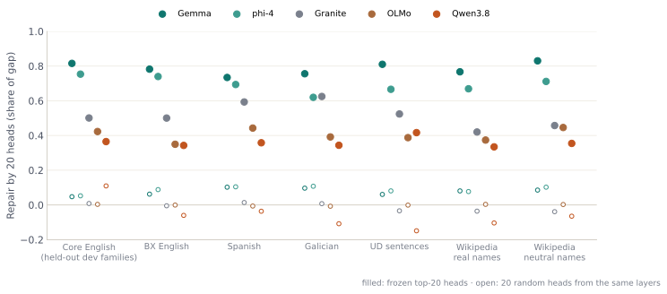

[← Order-to-Role](README.md) · [Results](RESULTS.md) · [Layers](LAYERS.md)

# Generality: models, constructions, languages and natural text

The question here is not whether a new search can find an influential component on every dataset. It is whether **the components identified on controlled English templates keep their causal effect elsewhere, unchanged**. For each model, its 20 heads were frozen on the core English development set and then applied as they are.

## 1. Evidence status of each material

| Material | What it tests | Status |
|:--|:--|:--|
| Core English | Decorrelated order, function and role | Development + **frozen test0** |
| BX transitive | New names, verbs, 18 constructions | Development + **frozen test0 replication** |
| BX ditransitive, psych | Other argument structures; experiencer vs subject | Development (exploratory) |
| Spanish | Another language, same name pairs | Development + **frozen test0 (primary)** |
| Galician | A lower-resource language | Development + **frozen test0 (secondary)** |
| Universal Dependencies (EWT/GUM) | Natural sentence contexts, names substituted | Validation (no test split) |
| WIKI-ROLES v0.2 | Natural Wikipedia sentences, real or neutral names | Validation (no test split) |
| Swedish | A Germanic language | **Excluded** until native-speaker check |
| Llama 3.3 70B, Qwen2.5 72B | Scale and new model families | Development (exploratory), separate freeze needed |

## 2. The same heads repair other materials

| Model | BX English | Spanish | Galician | UD | Wikipedia real | Wikipedia neutral | Overlap with fresh top-20 |
|:--|--:|--:|--:|--:|--:|--:|:--|
| Gemma 4 31B | .78 | .73 | .76 | .81 | .77 | .83 | 15–19 |
| phi-4 14B | .74 | .69 | .62 | .67 | .67 | .71 | 15–19 |
| Granite 4.2 30B | .50 | .59 | .62 | .52 | .42 | .46 | 13–16 |
| OLMo 3.1 32B | .35 | .44 | .39 | .39 | .37 | .45 | 14–17 |
| Qwen3.8 27B | .34 | .36 | .34 | .42 | .33 | .35 | 15–18 |

*Development data; random 20 heads from the same layers: −.15 to .11. Source: [`head_transfer_dev.csv`](results/tables/head_transfer_dev.csv), with item counts and per-set handover layers. Qwen3.8 on WIKI-ROLES v0.2 is now included (the earlier navigation page listed it as pending).*

**Confirmed on held-out names [test0]:** BX transitive (C5, all five models), Spanish and Galician (XL-C5 and XL-C5b, all ten model–language cells). Frozen-head repair on test0: Spanish .31–.71 and Galician .29–.74 above random heads.

## 3. The failure appears outside the templates

| Material | Gemma | Granite | Qwen3.8 | OLMo | phi-4 | Source |
|:--|--:|--:|--:|--:|--:|:--|
| BX transitive, failing (ordinary) | .86 (.99) | .85 (.90) | .61 (.90) | .41 (.88) | .13 (.90) | generation, computed |
| Spanish test0, failing (working) | .70 (1.00) | .41 (.91) | .68 (1.00) | .28 (.96) | .20 (1.00) | XL-C1 [test0] |
| Galician test0, failing (working) | .50 (1.00) | .57 (.95) | .55 (.95) | .44 (.97) | .48 (.98) | XL-C1 [test0] |
| UD actives, failing (working) | .50 (1.00) | .71 (.99) | .22 (1.00) | .15 (.99) | .41 (1.00) | first-token check, results log |
| Wikipedia actives, real / neutral names | .55 / .54 | .73 / .76 | .28 / .25 | .23 / .20 | .51 / .39 | first-token check, results log |

*UD and Wikipedia rows are transcribed from the [development results log](https://github.com/Joel-Vazquez-Lopez/llm-relational-mechanisms/blob/9c437928f61351a72e8d7be4cac6d3a964844a7e/docs/order_to_role/state_2026-11-25/results_log.md). They use a first-token comparison inside the bare-name prompt, not generation scoring. The Qwen3.8 Wikipedia value is from v0.1. The working question stays at .96 or above on natural text.*

The ditransitive ("Who was someone given the book by?") and psych blocks fail under the stranded "by" too, on development data. Gemma drops from 1.00 to .56 on ditransitives and from .95 to .45 on psych verbs. In fear-class actives Gemma names the grammatical object, whatever its thematic role. This suggests the local "someone V-ed … by" chunk fetches the object.

## 4. Real versus neutral names

WIKI-ROLES keeps the real names of each sentence and adds a copy with neutral replacement names. The two versions agree on accuracy (above), the handover layer (identical in Gemma, Granite and phi-4) and head repair (within .08). The effect therefore does not come from what the model knows about specific real people. This does not rule out that pretraining exposure to similar sentences contributes.

## 5. Larger models (exploratory)

| Model | Layers | Handover | Top-20 heads vs random (held-out dev) | Role peak |
|:--|--:|--:|:--|:--|
| Llama 3.3 70B Instruct | 80 | 38 (.48) | .47 vs .00 | layer 34: role 1.61 > order 0.56 > function 0.16 |
| Qwen2.5 72B Instruct | 80 | 58 (.73) | .44 vs .00 | not yet run |

A model family not in the core set (Llama) shows the same picture: a mid-network role code larger than order and function, a handover, and a small set of repairing heads. Neither model is frozen or tested.

## 6. Limitations of the generality evidence

- **Natural-text sets have no held-out split.** They were used for validation after development, and the heads were not re-selected on them.
- **UD sentences have names substituted** for the original participants.
- **WIKI-ROLES labels come from automatic parsing and named-entity recognition.** A manual check sheet exists ([`wiki_check_sheet.py`](https://github.com/Joel-Vazquez-Lopez/llm-relational-mechanisms/blob/9c437928f61351a72e8d7be4cac6d3a964844a7e/scripts/wiki_check_sheet.py)), but not every label is human-verified.
- **Spanish and Galician were checked by one native speaker, who is an author.** Galician items use a widespread but non-normative prepositional accusative; Spanish phrasing is sometimes formal.
- **Grammatical function is also positive in Spanish and Galician**, so the clean English role-over-function separation does not carry over unchanged. XL-C2 tests role > 0 only.
- **A transferred head ranking is within one model.** Head identities are not shared across architectures.
