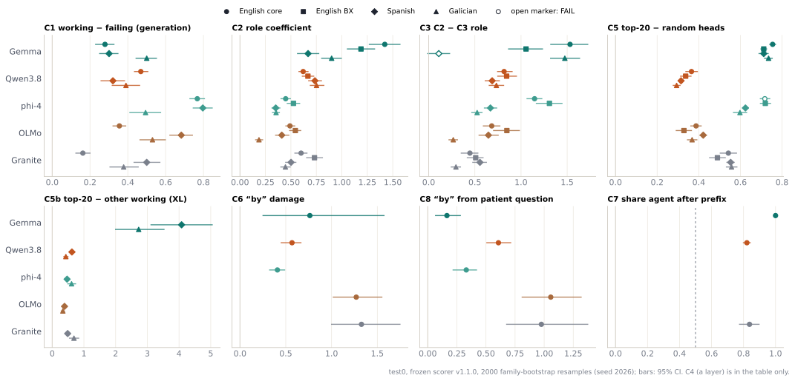

[← Supplement](README.md) · [Paper II](../README.md) · [Evidence ledger](../EVIDENCE.md)

# S1 · Statistics of the confirmatory evaluation

**Status: confirmatory.** All numbers on this page come from the frozen scorer [`otr_freeze_score.py`](https://github.com/Joel-Vazquez-Lopez/llm-relational-mechanisms/blob/9c437928f61351a72e8d7be4cac6d3a964844a7e/scripts/otr_freeze_score.py) v1.1.0 applied once to the test set 0 outputs. Bootstrap intervals use 2000 resamples of name-pair families with seed 2026. The claims, pass rules, layers and heads are defined in [FREEZE.md](https://github.com/Joel-Vazquez-Lopez/llm-relational-mechanisms/blob/9c437928f61351a72e8d7be4cac6d3a964844a7e/docs/order_to_role/FREEZE.md) (English, committed in `f6ea0e1`) and [FREEZE_XL.md](https://github.com/Joel-Vazquez-Lopez/llm-relational-mechanisms/blob/9c437928f61351a72e8d7be4cac6d3a964844a7e/docs/order_to_role/FREEZE_XL.md) (Spanish and Galician, `3811d7c`; the native-speaker check was added in `c40a1f7` before submission). This page reads the scorer's summaries in [`../results/confirmatory/`](../results/confirmatory/) and does not rescore anything. Full table: [`st01_confirmatory_test0_full.csv`](tables/st01_confirmatory_test0_full.csv), which includes every secondary field the scorer reports.

*Estimates and 95% CIs for every claim on test set 0. Filled markers pass, open markers fail. C4 is a layer and is shown only in the tables. The Gemma C5b values are on a different scale (see notes).*

## Claim definitions (short form)

| Claim | Measure | Pass rule (frozen) |
|:--|:--|:--|
| C1 | Generation accuracy, working minus failing question, on the same items (agent questions, 4 main constructions) | CI lower bound > 0 |
| C2 | OTR-03 role coefficient at the frozen role layer (ordinary questions, correct bases) | role CI and role − function CI both above 0 |
| C3 | C2 role minus the role coefficient under the failing question (wrong bases, agent questions) | CI lower bound > 0; at least 30 wrong bases |
| C4 | First sampled layer with residual repair ≥ .5 | within ±2 layers of the frozen handover; repair < .5 up to frozen − 4 |
| C5 | Repair by the 20 frozen heads minus 20 random heads from the same layers (5 draws) | CI lower bound > 0; top ≥ .25; `other_failing` and `random_nudge` ≤ .10 |
| C5b (XL only) | Frozen heads with the item's own working-run output vs another item's working-run output | CI lower bound > 0 |
| C6 | Damage from transplanting "by" from the failing question, at the frozen "by" layer | CI lower bound > 0 |
| C7 | Among wrong failing-question answers, share whose agent margin is positive after the prefix "Someone was V-ed by" (Gemma, Granite, Qwen3.8 only) | share > .5 and CI lower bound > .5; at least 20 items |
| C8 | Damage from transplanting "by" from the patient question into the working question | CI lower bound > 0 |

The full wording, measured fields and commands are in FREEZE.md §3 and §5 and FREEZE_XL.md §3.

## English core (C1–C8)

Verdict counts: Gemma 8/8, Qwen3.8 8/8, phi-4 6/7, OLMo 7/7, Granite 8/8, for **37 of 38** in total (C7 is not claimed for phi-4 or OLMo). `n` is the number of items or bases, `fam` the number of families resampled.

| Claim | Measure | Gemma | Qwen3.8 | phi-4 | OLMo | Granite |
|:--|:--|--:|--:|--:|--:|--:|
| C1 | `estimate` | 0.28 [0.23, 0.33] n=512, fam=59 | 0.47 [0.44, 0.51] n=512, fam=59 | 0.77 [0.73, 0.81] n=512, fam=59 | 0.36 [0.32, 0.39] n=512, fam=59 | 0.16 [0.13, 0.20] n=512, fam=59 |
| C2 | `role` | 1.42 [1.27, 1.57] fam=42 | 0.62 [0.58, 0.67] fam=42 | 0.45 [0.40, 0.50] fam=42 | 0.49 [0.45, 0.54] fam=42 | 0.60 [0.54, 0.66] fam=42 |
| C3 | `c2_minus_c3` | 1.53 [1.32, 1.72] n=154 | 0.82 [0.75, 0.90] n=125 | 1.15 [1.06, 1.23] n=194 | 0.68 [0.59, 0.77] n=95 | 0.45 [0.35, 0.53] n=58 |
| C4 | `first_crossing` | L40 | L54 | L22 | L26 | L52 |
| C5 | `top_minus_random` | 0.75 [0.74, 0.77] n=128, fam=56 | 0.36 [0.34, 0.39] n=121, fam=55 | **FAIL** 0.72 [0.70, 0.74] n=108, fam=53 | 0.39 [0.36, 0.41] n=107, fam=55 | 0.54 [0.50, 0.58] n=102, fam=54 |
| C6 | `damage` | 0.76 [0.25, 1.57] n=64, fam=40 | 0.57 [0.45, 0.67] n=59, fam=38 | 0.41 [0.32, 0.49] n=55, fam=37 | 1.27 [1.02, 1.55] n=54, fam=38 | 1.33 [1.00, 1.75] n=59, fam=37 |
| C7 | `share_agent_after_prefix` | 1.00 [1.00, 1.00] n=275, fam=59 | 0.82 [0.80, 0.84] n=486, fam=59 | no claim | no claim | 0.84 [0.78, 0.90] n=166, fam=53 |
| C8 | `damage` | 0.16 [0.07, 0.28] n=64, fam=40 | 0.61 [0.51, 0.71] n=59, fam=38 | 0.33 [0.22, 0.42] n=55, fam=37 | 1.06 [0.81, 1.32] n=54, fam=38 | 0.98 [0.68, 1.37] n=59, fam=37 |

## English BX replication (C2, C3, C5 on new names, verbs and constructions)

**15 of 15.**

| Claim | Measure | Gemma | Qwen3.8 | phi-4 | OLMo | Granite |
|:--|:--|--:|--:|--:|--:|--:|
| C2 | `role` | 1.19 [1.05, 1.32] fam=46 | 0.67 [0.61, 0.72] fam=32 | 0.53 [0.46, 0.59] fam=32 | 0.54 [0.49, 0.60] fam=32 | 0.73 [0.65, 0.81] fam=32 |
| C3 | `c2_minus_c3` | 1.05 [0.87, 1.23] n=120 | 0.84 [0.75, 0.95] n=65 | 1.31 [1.17, 1.44] n=94 | 0.85 [0.70, 0.98] n=51 | 0.51 [0.42, 0.59] n=33 |
| C5 | `top_minus_random` | 0.71 [0.70, 0.73] n=127, fam=98 | 0.34 [0.31, 0.36] n=125, fam=97 | 0.72 [0.70, 0.74] n=113, fam=92 | 0.33 [0.29, 0.36] n=120, fam=95 | 0.49 [0.45, 0.53] n=116, fam=92 |

## Spanish (XL addendum, primary language)

**29 of 30.** The handovers come from the Spanish development runs, not from English (FREEZE_XL.md §4).

| Claim | Measure | Gemma | Qwen3.8 | phi-4 | OLMo | Granite |
|:--|:--|--:|--:|--:|--:|--:|
| C1 | `estimate` | 0.30 [0.25, 0.35] n=492, fam=59 | 0.32 [0.26, 0.38] n=492, fam=59 | 0.80 [0.75, 0.85] n=492, fam=59 | 0.68 [0.62, 0.74] n=492, fam=59 | 0.50 [0.43, 0.57] n=492, fam=59 |
| C2 | `role` | 0.67 [0.57, 0.77] fam=42 | 0.74 [0.67, 0.80] fam=42 | 0.35 [0.31, 0.39] fam=42 | 0.41 [0.35, 0.48] fam=42 | 0.50 [0.45, 0.55] fam=42 |
| C3 | `c2_minus_c3` | **FAIL** 0.11 [−0.01, 0.23] n=126 | 0.69 [0.61, 0.77] n=57 | 0.67 [0.60, 0.74] n=225 | 0.65 [0.55, 0.75] n=143 | 0.56 [0.48, 0.63] n=146 |
| C4 | `first_crossing` | L48 | L50 | L22 | L24 | L52 |
| C5 | `top_minus_random` | 0.71 [0.69, 0.73] n=180, fam=57 | 0.31 [0.30, 0.33] n=185, fam=57 | 0.62 [0.61, 0.64] n=192, fam=57 | 0.42 [0.41, 0.44] n=174, fam=56 | 0.55 [0.54, 0.57] n=154, fam=56 |
| C5b | `top_minus_other_working` | 4.08 [3.12, 5.05] | 0.62 [0.55, 0.71] | 0.47 [0.44, 0.50] | 0.39 [0.34, 0.44] | 0.49 [0.43, 0.56] |

## Galician (XL addendum, secondary language)

**30 of 30.**

| Claim | Measure | Gemma | Qwen3.8 | phi-4 | OLMo | Granite |
|:--|:--|--:|--:|--:|--:|--:|
| C1 | `estimate` | 0.50 [0.44, 0.55] n=328, fam=59 | 0.39 [0.32, 0.46] n=328, fam=59 | 0.49 [0.41, 0.57] n=328, fam=59 | 0.53 [0.46, 0.60] n=328, fam=59 | 0.38 [0.31, 0.46] n=328, fam=59 |
| C2 | `role` | 0.90 [0.80, 0.99] fam=42 | 0.75 [0.69, 0.82] fam=42 | 0.35 [0.32, 0.39] fam=42 | 0.19 [0.15, 0.22] fam=42 | 0.45 [0.40, 0.49] fam=42 |
| C3 | `c2_minus_c3` | 1.47 [1.32, 1.63] n=142 | 0.73 [0.66, 0.81] n=71 | 0.52 [0.47, 0.58] n=190 | 0.27 [0.22, 0.31] n=173 | 0.30 [0.24, 0.34] n=104 |
| C4 | `first_crossing` | L48 | L50 | L22 | L26 | L52 |
| C5 | `top_minus_random` | 0.74 [0.72, 0.75] n=124, fam=52 | 0.29 [0.28, 0.31] n=105, fam=51 | 0.60 [0.57, 0.63] n=124, fam=52 | 0.37 [0.35, 0.39] n=124, fam=52 | 0.56 [0.53, 0.58] n=107, fam=52 |
| C5b | `top_minus_other_working` | 2.73 [2.00, 3.53] | 0.43 [0.37, 0.50] | 0.61 [0.49, 0.74] | 0.34 [0.29, 0.38] | 0.69 [0.55, 0.83] |

## Notes

- **phi-4 C5 fails on a control, not on repair.** Top-20 repair is .72 against .01 for random heads, but the `other_failing` control repaired .26, above the frozen .10 limit. The [evidence ledger](../EVIDENCE.md#phi-4-c5) explains why that control does not isolate item-specific content, and why the addendum used C5b instead. The English failure stands.
- **Gemma Spanish C3 fails.** C2 − C3 = 0.11, CI [−0.01, 0.23]. The development value (.08) had predicted this.
- **Gemma C5b scale.** The values 4.08 and 2.73 are large because another item's working output pushes Gemma's answer strongly the wrong way. The verdicts are valid, but the magnitudes should not be compared across models.
- **Sign predictions (secondary, English C3).** The read-out under the failing question on wrong items: Gemma −0.11 (CI includes zero), Qwen3.8 −0.20, phi-4 −0.70, OLMo −0.19, Granite +0.15. All five match FREEZE.md's predictions. These values are in the `other_fields` column of the CSV.
- **C6 for Gemma has a wide interval** ([0.25, 1.57]) with 64 items. The verdict holds, but the size of the effect is uncertain.
- **Families differ between claims** because each claim uses a different run: 64 OTR-03 events cover 42 families; generation covers all 59.
- **Multiple comparisons.** FREEZE.md §3 states that no multiple-comparison correction is applied to these replication criteria, and that the paper will say so. Every estimate and interval is shown here so that readers can apply their own correction.
