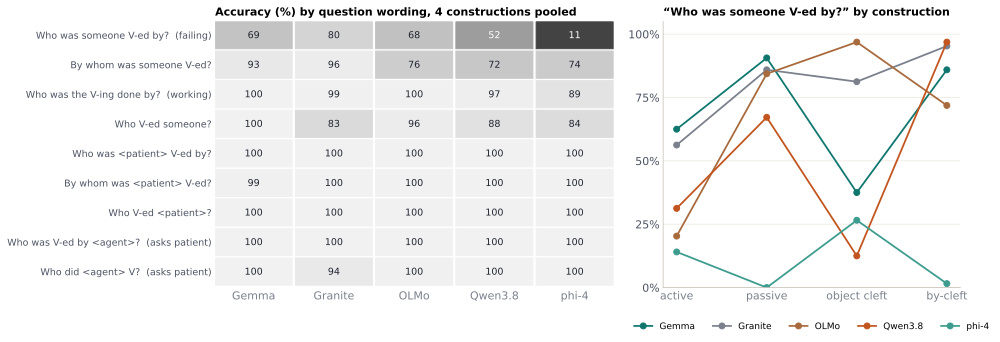
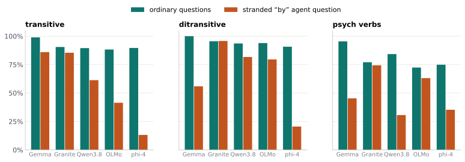
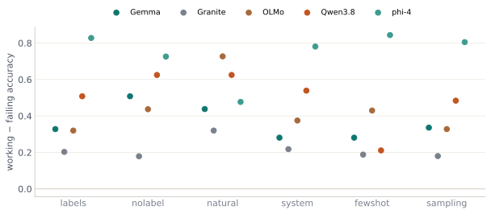

[← Supplement](README.md) · [Paper II](../README.md) · [Methods](../METHODS.md)

# S2 · Linguistic controls

**Status: development split, exploratory**, unless marked otherwise. These controls ask what the failure depends on: the question's wording, the sentence's construction, the verb class or the prompt format. Accuracy is the share of answers credited as correct by the generation extractor of `otr_generate_check.py`, under greedy decoding with the instruction "Reply with one name only." and the model's chat template, unless a row says otherwise.

## 1. Which part of the question causes the failure?

One battery, run on 26 November with the same items, instruction, template and extractor for every wording. Each cell is n = 256: 4 constructions × 64 items. Source: [`st02_question_wording_dev.csv`](tables/st02_question_wording_dev.csv), with one result file per cell.

*Left: accuracy (%) by question wording. Right: the failing wording by construction.*

| Question | Asks for | Gemma | Qwen3.8 | phi-4 | OLMo | Granite |
|:--|:--|--:|--:|--:|--:|--:|
| Who was someone V-ed by? *(failing)* | agent | 69 | 52 | 11 | 68 | 80 |
| By whom was someone V-ed? | agent | 93 | 72 | 74 | 76 | 96 |
| Who was the V-ing done by? *(working)* | agent | 100 | 97 | 89 | 100 | 99 |
| Who V-ed someone? | agent | 100 | 88 | 84 | 96 | 83 |
| Who was ⟨patient⟩ V-ed by? | agent | 100 | 100 | 100 | 100 | 100 |
| By whom was ⟨patient⟩ V-ed? | agent | 99 | 100 | 100 | 100 | 100 |
| Who V-ed ⟨patient⟩? | agent | 100 | 100 | 100 | 100 | 100 |
| Who was V-ed by ⟨agent⟩? | patient | 100 | 100 | 100 | 100 | 100 |
| Who did ⟨agent⟩ V? | patient | 100 | 100 | 100 | 100 | 94 |

- **The failure needs the combination of "someone" and a stranded "by".** When the question names the other participant (*Who was ⟨patient⟩ V-ed by?*), accuracy is 100% in every model, even with "by" still stranded. Moving "by" to the front (*By whom was someone V-ed?*) recovers much of the gap but not all: 72–96%.
- **The working question is not the only ordinary one.** *Who V-ed someone?* is also high (83–100%), so the working question is not special.
- **Questions that ask for the patient are at ceiling** (94–100%). The failure is specific to agent questions in this form.
- One caveat: the named-participant questions hand the model a name to exclude, so they make the task easier as well as changing the syntax. They control for wording, not for difficulty.

### The failing question by construction

| Model | active | passive | object cleft | by-cleft |
|:--|--:|--:|--:|--:|
| Gemma | 62 | 91 | 38 | 86 |
| Qwen3.8 | 31 | 67 | 12 | 97 |
| phi-4 | 14 | 0 | 27 | 2 |
| OLMo | 20 | 84 | 97 | 72 |
| Granite | 56 | 86 | 81 | 95 |

Each model fails on a different subset of constructions. Gemma and Qwen3.8 fail mostly on the active and the object cleft. Descriptively, these are the two constructions whose sentence contains no "by" phrase for the question's "by" to match. phi-4 fails almost everywhere, including 0% on passives. OLMo fails on the active but not on the object cleft (97%). These patterns differ too much to support one construction-level explanation, so the paper does not offer one. The OTR-09 baselines in [S3](S3-layerwise-and-heads.md#2-repair-at-the-answer-position-by-construction) show the same per-construction pattern in the logit margins.

## 2. Broader English constructions (BX blocks)

BX uses 48 new names and new verbs, and adds 14 further transitive frames (perfect, progressive, get-passive, coordination, relatives, adjuncts, long clefts) as well as ditransitive and psych-verb blocks. *Failing* means the stranded-"by" question for the participant that a by-phrase would introduce. Source: [`st03_bx_blocks_dev.csv`](tables/st03_bx_blocks_dev.csv); per-construction accuracies are in its last JSON column. Only the transitive block was frozen (C2, C3 and C5 on test0, [S1](S1-statistics.md#english-bx-replication-c2-c3-c5-on-new-names-verbs-and-constructions)).

| Model | Transitive: ordinary / failing | Ditransitive: ordinary / failing | Psych: ordinary / failing |
|:--|--:|--:|--:|
| Gemma | 99 / 86 | 100 / 56 | 95 / 45 |
| Qwen3.8 | 90 / 61 | 94 / 82 | 84 / 31 |
| phi-4 | 90 / 13 | 91 / 21 | 75 / 35 |
| OLMo | 88 / 41 | 94 / 80 | 72 / 63 |
| Granite | 90 / 85 | 96 / 96 | 77 / 74 |

- The drop reappears with new names and verbs and in all three blocks. Granite is the exception: its ditransitive block shows no drop (96 / 96).
- The psych block has lower ordinary accuracy (72–95%), so its gaps start from a lower ceiling.
- The model ranking is not stable across blocks. OLMo is weak on transitives (41%) but fairly strong on ditransitives (80%).

## 3. Is the failure a prompt-format artefact? (OTR-15)

The failing and working questions on the same balanced items (n = 128 per question), in six prompt formats: the standard labelled format, no labels, a natural sentence frame, a system message, two solved examples with ordinary questions, and sampling (temperature 0.7, top-p 0.95) instead of greedy decoding. Formats are defined in [`otr15_prompt_robustness.py`](https://github.com/Joel-Vazquez-Lopez/llm-relational-mechanisms/blob/9c437928f61351a72e8d7be4cac6d3a964844a7e/scripts/otr15_prompt_robustness.py). Source: [`st04_prompt_formats_dev.csv`](tables/st04_prompt_formats_dev.csv).

Working / failing accuracy (%):

| Model | labels | nolabel | natural | system | fewshot | sampling |
|:--|--:|--:|--:|--:|--:|--:|
| Gemma | 100 / 67 | 100 / 49 | 100 / 56 | 100 / 72 | 100 / 72 | 100 / 66 |
| Qwen3.8 | 99 / 48 | 99 / 37 | 100 / 38 | 100 / 46 | 99 / 78 | 99 / 51 |
| phi-4 | 91 / 9 | 98 / 26 | 96 / 48 | 96 / 18 | 98 / 13 | 92 / 12 |
| OLMo | 99 / 67 | 95 / 52 | 100 / 27 | 100 / 62 | 100 / 57 | 99 / 66 |
| Granite | 99 / 79 | 98 / 80 | 98 / 66 | 98 / 77 | 100 / 81 | 96 / 78 |

The gap stays positive in every model and format, from 18 points (Granite, nolabel) to 84 points (phi-4, fewshot). Format changes its size: Qwen3.8's failing accuracy ranges from 37% to 78% across formats. It does not remove the gap. The few-shot examples use ordinary questions only, so they do not teach the failing wording.

## 4. Stimulus inventory and design checks

These are design facts from the generators: names, verbs, constructions, and families and items per split, counted without any model output. Source: [`st05_stimulus_inventory.csv`](tables/st05_stimulus_inventory.csv).

| Material | Generator | Names | Verbs | Constructions | Families (dev / test0 / test1–3) | Dev items |
|:--|:--|--:|--:|--:|:--|--:|
| English core (OTR) | v1.3.0 | 24 | 16 | 7 | 41 / 59 / 59, 59, 58 | 4592 |
| Spanish (XL) | v1.0.0 | 24 | 16 | 6 | 41 / 59 / 59, 59, 58 | 3936 |
| Galician (XL) | v1.0.0 | 24 | 16 | 6 | 41 / 59 / 59, 59, 58 | 3936 |
| English BX transitive | v0.1.0 | 48 | 45 | 18 | 169 / 240 / 240, 240, 239 | 24336 |
| English BX ditransitive | v0.1.0 | 48 | 10 | 7 | 169 / 240 / 240, 240, 239 | 9464 |
| English BX psych | v0.1.0 | 48 | 22 | 6 | 169 / 240 / 240, 240, 239 | 8112 |

- **Order, function and role are exactly decorrelated** in the four main English constructions. The pairwise label correlations computed from the generated items are first–subject 0.000, first–agent 0.000 and subject–agent 0.000.
- **Families** are unordered name pairs. Each family belongs to exactly one split (15% development, then four test sets). Only test set 0 has been opened. Test sets 1–3 remain closed.
- **Names** are 24 gender-balanced first names, shared across English, Spanish and Galician. Patching runs check for each tokenizer that every name is a single token and that the first answer tokens are distinct (`check_names_for_patching`). OTR-09 also records how many items it skipped because two names share a first token (`n_skipped_shared_first_token`). BX uses a separate list of 48 names. Verbs are reversible and plausibility-neutral.
- **Spanish and Galician linguistic notes** (native check, FREEZE_XL.md §6): the Spanish items were judged correct, with some phrasing more formal than colloquial. The Galician items use the prepositional accusative with persons ("visitou a alguén"), which is widespread in speech but non-normative. The periphrastic passive is grammatical but less idiomatic, and by-clefts are forced. None of this affects the failing question, which has no "a". The items were kept unchanged so that test0 matches development.

## 5. What these controls do not settle

- The battery in §1 compares wordings, not parses. It shows *which* strings fail, not *how* the models parse them. The layer evidence for "by" is in [S3](S3-layerwise-and-heads.md) and in the main [Layers](../LAYERS.md) page.
- BX ditransitive and psych blocks, and OTR-15, were not frozen and remain exploratory.
- Earlier wording experiments (stranded-P frames, verb-level breakdowns, 16 November) used an older extractor and are listed under [historical packages](historical-packages.md).
