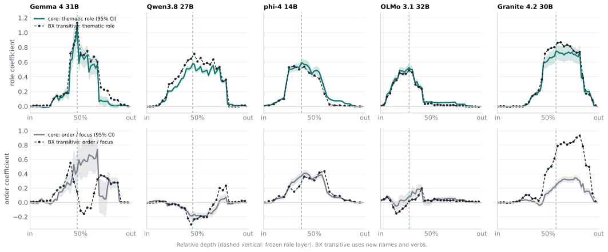
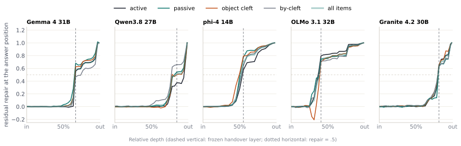
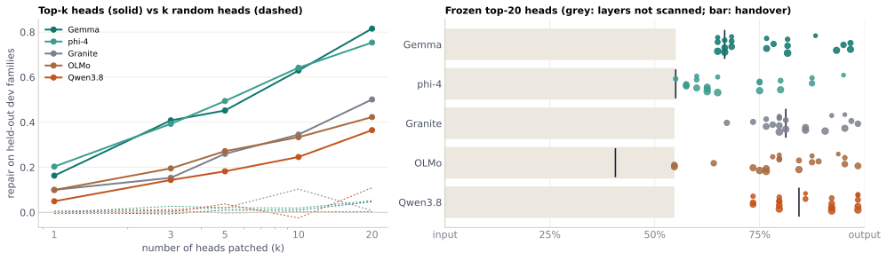
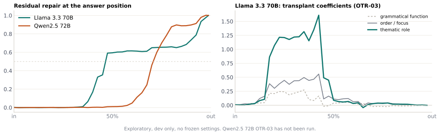

[← Supplement](README.md) · [Paper II](../README.md) · [Layers and mechanism](../LAYERS.md) · [Interventions](../INTERVENTIONS.md)

# S3 · Layerwise and head analyses

**Status: development split, exploratory.** The frozen layers and heads were chosen on these same files. These curves therefore describe the data the choices were made from. They are not tests (the tests are in [S1](S1-statistics.md)). Methods: [METHODS §4–6](../METHODS.md#4-name-state-transplantation-otr-03).

## 1. Role and order codes with confidence bands, core vs BX

OTR-03 transplant coefficients at every layer, with the per-layer 95% CI from the run's own bootstrap. The BX transitive run (new names, verbs and frames) is overlaid on a coarser layer grid. Source: [`st06_role_code_by_layer_dev.csv`](tables/st06_role_code_by_layer_dev.csv), which also holds the grammatical-function coefficient and its CI at every layer.

| Model | Core role peak (layer, value) | Layers with role CI above 0 | Function range across layers | Order range across layers | BX role peak (layer, value) |
|:--|:--|:--|:--|:--|:--|
| Gemma | L28, 1.08 | 42 of 60 (L3–L58) | −0.25 to 0.09 | −0.02 to 0.74 | L28, 1.13 |
| Qwen3.8 | L29, 0.58 | 55 of 64 (L8–L62) | −0.08 to 0.09 | −0.19 to 0.08 | L30, 0.71 |
| phi-4 | L15, 0.59 | 37 of 40 (L0–L36) | −0.20 to 0.00 | −0.01 to 0.41 | L12, 0.55 |
| OLMo | L18, 0.53 | 60 of 64 (L0–L60) | −0.28 to 0.01 | −0.05 to 0.19 | L18, 0.49 |
| Granite | L37, 0.75 | 47 of 64 (L10–L62) | −0.21 to 0.06 | −0.04 to 0.34 | L40, 0.87 |

- **The role peak replicates on BX** within three layers in every model.
- **Many layers have a role CI above zero, but most of them are tiny.** Near the input and output the coefficients are close to zero with tight intervals. The meaningful quantity is the peak and the plateau around it, not the count of "significant" layers.
- **Order or focus is not a nuisance term everywhere.** In Gemma it reaches 0.74 at L40, which is the handover layer and lies past the role peak; on BX it peaks at 0.55 (L24). In Granite BX it reaches 0.93 at L52, again the handover layer. In the main constructions order coincides with focus (the clefted name comes first), so these runs cannot say which of the two it is. This is why the paper claims role > function and does not claim that order is absent ([evidence ledger, corrections](../EVIDENCE.md#6-corrections-and-disclosures)).
- **The validity null is exactly 0.0 at every layer in every model.** For transplants between sources with identical left context, the role slope must vanish, and it does.

## 2. Repair at the answer position, by construction

OTR-09 residual repair, (patched − failing) / (working − failing), when the working question's residual stream at the answer position replaces the failing one's. Shown for each construction separately and for all items together. Source: [`st07_residual_repair_by_construction_dev.csv`](tables/st07_residual_repair_by_construction_dev.csv), which also gives each construction's baseline (share of items where the failing question prefers the agent).

First layer with repair ≥ .5:

| Model | All items | Active | Passive | Object cleft | By-cleft | Frozen handover |
|:--|--:|--:|--:|--:|--:|--:|
| Gemma | 40 | 40 | 40 | 40 | 46 | 40 |
| Qwen3.8 | 54 | 62 | 52 | 50 | 50 | 54 |
| phi-4 | 22 | 22 | 22 | 20 | 22 | 22 |
| OLMo | 26 | 24 | 26 | 26 | 26 | 26 |
| Granite | 52 | 52 | 52 | 52 | 52 | 52 |

- The handover depth is largely shared across constructions, even though the behavioural failure differs by construction ([S2 §1](S2-linguistic-controls.md#the-failing-question-by-construction)). The largest spread is in Qwen3.8 (L50–L62), where active items hand over latest.
- The cells are small, 17–32 items per construction. In OLMo, object-cleft repair dips to −0.21 before the handover (21 items).
- Baselines (the share of items where the failing question still prefers the agent) range from 0% (phi-4 passive) to 100% (Qwen3.8 by-cleft; OLMo object cleft). Repair is computed only on items with a working–failing margin of at least 1.0 logit.

## 3. How many heads, and where they are

The OTR-09 head scan ranks heads on 24 items. Repair by the top-k heads is then measured on held-out development families (42–51 items) and compared with k random heads from the same layers. Sources: [`st08_heads_k_curve_dev.csv`](tables/st08_heads_k_curve_dev.csv) and [`st09_top20_heads_dev.csv`](tables/st09_top20_heads_dev.csv) (rank, head, layer and scan score of each frozen head).

| Model | k = 1 | k = 3 | k = 5 | k = 10 | k = 20 | Random 20 | Scanned layers | Handover | Head layers (min–median–max) |
|:--|--:|--:|--:|--:|--:|--:|:--|--:|:--|
| Gemma | .16 | .41 | .45 | .63 | .82 | .05 | 33–59 | 40 | 39–46–58 |
| phi-4 | .20 | .39 | .49 | .64 | .75 | .05 | 22–39 | 22 | 22–26–38 |
| Granite | .10 | .15 | .26 | .35 | .50 | .01 | 35–63 | 52 | 43–52–63 |
| OLMo | .10 | .20 | .27 | .33 | .42 | .00 | 35–63 | 26 | 35–51–63 |
| Qwen3.8 | .05 | .14 | .18 | .25 | .36 | .11 | 35–63 | 54 | 47–59–63 |

- **Repair grows steadily with k and has not saturated at 20** in any model. "20 heads" is a fixed budget, not the size of a complete circuit.
- **Random heads stay low** (≤ .11 at k = 20). Single random draws fluctuate: Granite's k = 10 random set repairs .10, and its k = 20 set .01.
- **Head locations depend on the scan window.** Heads were scanned only in the layers listed. For OLMo the scan began at L35, after its handover at L26, so its frozen heads cannot include heads near the handover. In Gemma, phi-4 and Granite the scan covers the handover. The head-location result is therefore "late heads suffice", not "the readout heads are late".

## 4. The 70B-class models (exploratory)

Llama 3.3 70B and Qwen2.5 72B were run on development data only, with no frozen settings ([`BIG_MODELS.md`](https://github.com/Joel-Vazquez-Lopez/llm-relational-mechanisms/blob/9c437928f61351a72e8d7be4cac6d3a964844a7e/docs/order_to_role/BIG_MODELS.md)). Source: [`st10_big_models_curves_dev.csv`](tables/st10_big_models_curves_dev.csv).

- The handover is at L38 of 80 for Llama and L58 of 80 for Qwen2.5 72B. The same kind of step appears as in the five core models, at very different depths.
- Llama's role coefficient peaks at L34 (1.61), with order 0.56 and function 0.16 at the same layer. The ordering role > order > function matches Gemma and Granite.
- Qwen2.5 72B OTR-03 has not been run, so there is no role-code curve for it.
