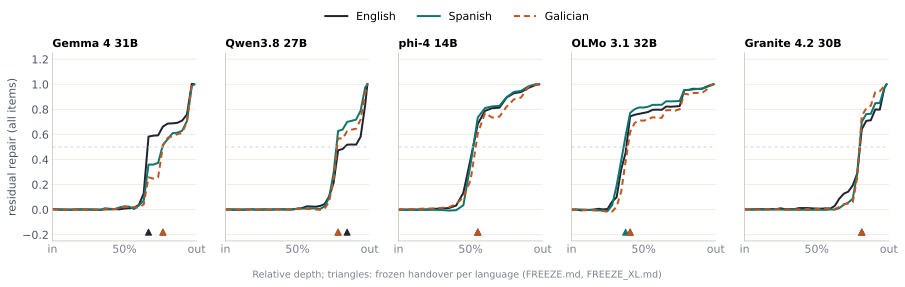

[← Supplement](README.md) · [Paper II](../README.md) · [Generality](../TRANSFER.md)

# S5 · Multilingual evidence

**Status.** The Spanish and Galician results on test set 0 are **confirmatory** ([S1](S1-statistics.md#spanish-xl-addendum-primary-language)). Everything on this page is **development, exploratory**. The Swedish pilot also lacks a native-speaker check.

## 1. Design

The XL generator ([`multilingual_stimuli.py`](https://github.com/Joel-Vazquez-Lopez/llm-relational-mechanisms/blob/9c437928f61351a72e8d7be4cac6d3a964844a7e/src/relational_lab/experiments/multilingual_stimuli.py), v1.0.0) uses the same 24 names, 16 verbs and family partition as English. It renders five constructions in Spanish and Galician: active, periphrastic passive, object cleft, by-cleft and a clitic-doubled OVS order (Galician examples: *Alice abrazou a Frank* · *Frank foi abrazado por Alice* · *Foi a Frank a quen abrazou Alice* · *Foi por Alice por quen Frank foi abrazado* · *A Frank abrazouno Alice*). A subject cleft is generated as a control.

The failing question is the passive agent question. Romance languages do not allow preposition stranding, so the preposition is fronted: *¿Por quién fue V-ado alguien?* / *Por quen foi V-ado alguén?*. This corresponds to the English *By whom was someone V-ed?*, which also falls short of ceiling (72–96%, [S2 §1](S2-linguistic-controls.md#1-which-part-of-the-question-causes-the-failure)), rather than to the stranded English wording. The working question is the active agent question, *¿Quién V-ó a alguien?* / *Quen V-ou a alguén?*. Instructions: "Responde con un solo nombre." / "Responde cun só nome."

## 2. Behaviour by construction

Agent questions, working (active-voice question) / failing (passive-voice question), in %. Each cell has 82 items, and "overall" pools all 20 cells of the run (n = 1640). Source: [`st11_multilingual_behaviour_dev.csv`](tables/st11_multilingual_behaviour_dev.csv), which also holds the patient-question cells.

**Spanish**

| Model | Overall | active | passive | object cleft | by-cleft | OVS clitic |
|:--|--:|--:|--:|--:|--:|--:|
| Gemma | 93 | 100 / 68 | 100 / 100 | 100 / 34 | 71 / 94 | 100 / 99 |
| Qwen3.8 | 89 | 100 / 56 | 100 / 100 | 100 / 56 | 45 / 99 | 100 / 95 |
| phi-4 | 74 | 100 / 9 | 100 / 59 | 100 / 4 | 7 / 7 | 100 / 13 |
| OLMo | 68 | 100 / 0 | 99 / 67 | 78 / 27 | 88 / 73 | 87 / 12 |
| Granite | 81 | 100 / 21 | 82 / 67 | 95 / 30 | 66 / 61 | 99 / 68 |

**Galician**

| Model | Overall | active | passive | object cleft | by-cleft | OVS clitic |
|:--|--:|--:|--:|--:|--:|--:|
| Gemma | 71 | 100 / 1 | 100 / 99 | 71 / 45 | 61 / 71 | 38 / 65 |
| Qwen3.8 | 77 | 100 / 32 | 93 / 84 | 100 / 23 | 57 / 93 | 62 / 46 |
| phi-4 | 70 | 100 / 18 | 95 / 76 | 62 / 28 | 45 / 29 | 35 / 52 |
| OLMo | 58 | 100 / 22 | 88 / 83 | 5 / 35 | 43 / 70 | 2 / 63 |
| Granite | 69 | 100 / 46 | 95 / 62 | 55 / 37 | 95 / 74 | 38 / 68 |

- **The passive-voice agent question fails in both languages.** The failure is largest on actives and object clefts and smallest on passives, which is close to the English pattern for Gemma and Qwen3.8.
- **Some "working" cells are low too.** In the by-cleft and the Galician OVS clitic order, the active-voice question is weak in several models (phi-4 Spanish by-cleft 7%, OLMo Galician OVS 2%). For this reason the frozen XL-C1 uses only the constructions where the working question works: Spanish active, passive and object cleft; Galician active and passive (FREEZE_XL.md §3).
- **Galician is harder overall** (58–77% against 68–93% in Spanish). That fits its non-normative prepositional accusative and forced by-clefts (native-speaker notes in [S2 §4](S2-linguistic-controls.md#4-stimulus-inventory-and-design-checks)).

## 3. Handover by language

First development layer with residual repair ≥ .5, recomputed from the files and identical to the frozen values in all 15 cells. Source: [`st12_handover_by_language_dev.csv`](tables/st12_handover_by_language_dev.csv).

| Model | Layers | English | Spanish | Galician |
|:--|--:|--:|--:|--:|
| Gemma | 60 | 40 | 46 | 46 |
| Qwen3.8 | 64 | 54 | 50 | 50 |
| phi-4 | 40 | 22 | 22 | 22 |
| OLMo | 64 | 26 | 24 | 26 |
| Granite | 64 | 52 | 52 | 52 |

The step from "question matters" to "answer position decides" happens in every language. Its depth is the same across languages in phi-4 and Granite and shifts by 2–6 layers in the other three. This is why FREEZE_XL.md froze language-specific handovers and reported the English layer only descriptively. On test0, every XL-C4 first crossing fell within ±2 layers of the frozen language-specific value ([S1](S1-statistics.md)). The same frozen English heads repair Spanish (.36–.73) and Galician (.34–.76), with random heads at ≤ .11 ([main transfer table](../TRANSFER.md#2-the-same-heads-repair-other-materials)).

## 4. Swedish pilot (unchecked)

**Status: exploratory, not checked by a native speaker.** The [check sheet](https://github.com/Joel-Vazquez-Lopez/llm-relational-mechanisms/blob/9c437928f61351a72e8d7be4cac6d3a964844a7e/docs/order_to_role/swedish_check_sheet.md) is still blank, so these numbers are not evidence. They are listed so that the run is not lost. Swedish has two passives, the periphrastic *blev* passive and the morphological s-passive, and it allows preposition stranding. Generator SV 0.1.0, n = 512 per run, instruction "Svara med ett enda namn." Source: [`st13_swedish_dev_unchecked.csv`](tables/st13_swedish_dev_unchecked.csv).

| Model | Ordinary questions | *Vem blev någon V-d av?* | *Vem V-des någon av?* |
|:--|--:|--:|--:|
| Gemma | 88 | 36 | 31 |
| Qwen3.8 | 79 | 11 | 23 |
| phi-4 | 68 | 29 | 9 |
| OLMo | 65 | 10 | 14 |
| Granite | 68 | 43 | 44 |

Both stranded passive questions are far below ordinary questions in every model. Before this can be interpreted, the native check must be done, and the low ordinary accuracy (65–88%) must be understood.

## 5. Limits

- Spanish and Galician share names, verbs and families with English. They test the language of the template, not new lexical material. BX does that for English only.
- No Spanish or Galician natural-text material has been run. The UD and Wikipedia transfers are English only.
- FREEZE_XL.md §6 notes that a normative Galician variant (without the prepositional "a") may be run later as exploratory work. It has not been run.
